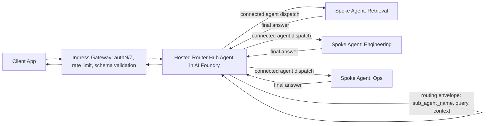

# AI Foundry Multi-Agent Systems: Hosted Router Hub Agent with Agent Service Spokes

This is an **alternative design** to the FastAPI Hub described in [README.md](README.md).

Instead of running the Hub as a FastAPI service on AKS, the **Hub becomes a hosted agent inside Azure AI Foundry** that acts as the **Router Agent**. The hosted Hub agent decides which spoke sub-agent should handle a request, returns a routing envelope (`sub_agent_name`, `query`, `context`), forwards the request to the selected spoke, and returns the spoke's final response to the caller.

> Use this design when you want to minimize control-plane infrastructure and lean on Foundry Agent Service for orchestration, threads, and tracing. Use the FastAPI design in [README.md](README.md) when you need a hard, code-owned policy gate.

## Core Idea

- The **Hub** is a Foundry **hosted agent** (the Router Agent) — no FastAPI service to operate.
- A thin **ingress gateway** (Azure API Management or a small façade) sits in front for governance only: authentication, rate limiting, and request/response schema validation.
- The Hub agent uses the Foundry **Connected Agents** pattern to delegate to spoke agents.
- The Router decides routing and returns a typed envelope: `sub_agent_name`, `query`, `context`.
- The Hub forwards to the selected spoke, which processes the task and returns a final response back through the Hub.

## How This Differs From the FastAPI Design

| Concern | FastAPI Hub (README.md) | Hosted Router Hub Agent (this doc) |
| --- | --- | --- |
| Hub runtime | FastAPI container on AKS | Foundry hosted agent (Agent Service) |
| Orchestration | Application code | Connected Agents delegation |
| Routing logic | Deterministic code | Model-driven with structured JSON output |
| Conversation state | App-managed (Cosmos/Redis) | Foundry threads (+ optional Cosmos/Redis) |
| Scaling | AKS pods / HPA | Managed by Foundry |
| Policy enforcement point | The Hub itself | Thin ingress gateway in front of Foundry |
| Observability | Custom app metrics | Foundry tracing (+ custom where needed) |
| Operational surface | Larger (own the service) | Smaller (own the gateway only) |

## Logical Request Flow



## Why This Design Works Well

- **Less infrastructure to own.** Removing the FastAPI service eliminates a stateful workload, its container image, scaling configuration, and part of the AKS surface dedicated to the Hub.
- **Native Foundry fit.** The Agent Service **Connected Agents** capability is purpose-built for a main orchestrator agent that delegates to sub-agents — exactly the Hub → spoke pattern.
- **Built-in primitives.** Threads, tool calling, and tracing come from the platform, reducing custom plumbing.
- **Simpler routing wiring.** The Router's only job is to choose `sub_agent_name`, rewrite `query`, and pass `context`, which is the natural shape of a connected-agent orchestrator.

## Trade-offs To Manage Deliberately

- **Keep a policy gate in front.** A hosted agent is model-driven and is not a deterministic policy enforcement point. Retain a thin ingress gateway (APIM or a small façade) for authentication, authorization, rate limiting, abuse controls, and schema validation.
- **Make routing safe despite being probabilistic.** Enforce **structured outputs** (JSON schema) on the Router and validate them. Apply confidence thresholds and a `fallback_agent`.
- **Plan private networking/egress.** Agent-to-agent delegation stays inside Foundry, but any spoke that depends on private resources (AKS services, private endpoints) still needs a private path and DNS.
- **Augment observability where needed.** Inherit Foundry tracing, but add custom metrics/alerts for route quality, fallback frequency, and per-spoke latency/error rates if those matter to your SLOs.

## Route Contract

Do not use free-text routing decisions. The Router Hub agent must emit a typed JSON envelope, validated at the ingress gateway before dispatch.

```json
{
  "sub_agent_name": "retrieval_spoke",
  "query": "summarized or rewritten task for the selected spoke",
  "context": {
    "user_intent": "knowledge_lookup",
    "conversation_id": "abc-123",
    "constraints": ["cite_sources"]
  },
  "confidence": 0.92,
  "fallback_agent": "generalist_spoke",
  "safety_flags": ["none"],
  "trace_id": "trace-xyz"
}
```

Routing policy:
- **High confidence:** delegate directly to `sub_agent_name`.
- **Medium confidence:** delegate with additional gateway validation rules.
- **Low confidence:** use `fallback_agent` or return a clarification prompt.

## Responsibility Boundaries

- **Ingress Gateway** owns governance: authN/Z, rate limiting, prompt-injection and safety checks, request/response schema validation, optional redaction.
- **Hosted Router Hub Agent** owns orchestration and routing metadata only (`sub_agent_name`, `query`, `context`, `confidence`).
- **Spoke Agents** own the final domain responses.

## Implementation Outline

1. **Provision Foundry resources.** Reuse `modules/ai_foundry` (Hub/Project + AI Services) and `modules/ai_foundry_identity`.
2. **Create the Router Hub agent** in the Foundry Project with instructions to emit the route envelope and to delegate via Connected Agents.
3. **Register spoke agents** as connected agents (Retrieval, Engineering, Ops, etc.), each scoped to its domain tools (AI Search, Cosmos DB, Redis).
4. **Stand up the ingress gateway** (APIM recommended) for authentication, rate limiting, and JSON-schema validation of the route envelope.
5. **Wire private networking** so spokes can reach private endpoints (Key Vault, AI Search, Cosmos DB, ACR) over private DNS.
6. **Enable tracing and evaluation** to monitor route accuracy and spoke quality.

### Infrastructure Modules Reused

- `modules/ai_foundry`: Foundry Hub/Project + AI Services that host the Router Hub agent and spokes.
- `modules/ai_foundry_identity`: platform identity for Foundry hub/project.
- `modules/ai_search`: retrieval backing for retrieval-style spokes.
- `modules/cosmosdb`, `modules/redis`: optional state/cache for spokes.
- `modules/keyvault`, `modules/monitoring`, `modules/vnet`: secrets, observability, and private networking.

Modules that may be reduced or removed compared to the FastAPI design:
- The Hub no longer needs a dedicated FastAPI workload on AKS. AKS (`modules/aks`) is still useful if any spoke or tool runs as a private containerized service, but the Hub itself does not require it.

## Recommended Practices

- **Strong route contract:** typed JSON envelope, validated before dispatch.
- **Confidence-based routing:** direct, validated, or fallback paths.
- **Gateway as the policy point:** enforce governance before and after delegation.
- **Observability at route and spoke levels:** router latency/confidence, per-spoke latency/error rate, fallback frequency, end-to-end trace correlation via `trace_id`.
- **Safe failure:** timeout budgets per hop, retries with backoff, per-spoke circuit breakers, deterministic fallbacks.
- **Version and evaluate continuously:** version router and spoke instructions independently, maintain route-accuracy datasets, gate releases on quality and safety thresholds.

## When To Choose Which Design

- Choose this **Hosted Router Hub Agent** design when you want minimal control-plane infrastructure, native Foundry orchestration, and are comfortable enforcing governance at a thin ingress gateway.
- Choose the **FastAPI Hub** design in [README.md](README.md) when you need a fully code-owned policy enforcement point, deterministic routing, or deep custom observability and control over every hop.
