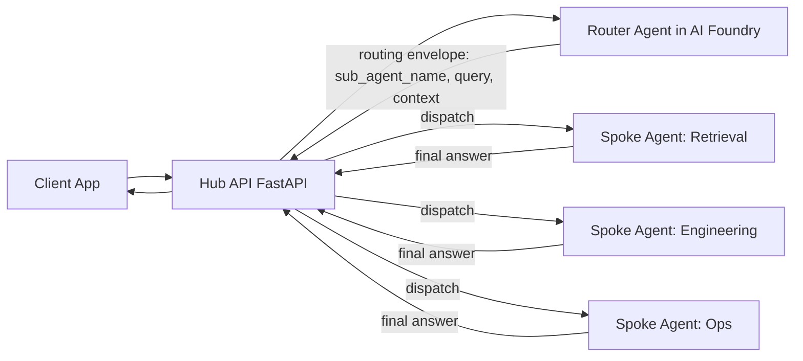

# AI Foundry Hub-and-Spoke Multi-Agent Infrastructure

This repository provisions a secure Azure foundation for a hub-and-spoke multi-agent system using Terraform.

The core idea is:
- The Hub exposes a FastAPI endpoint.
- The Hub forwards user intent to a Router Agent in Azure AI Foundry.
- The Router Agent decides which spoke sub-agent should handle the request and returns routing details to the Hub: `sub_agent_name`, `query`, and `context`.
- The Hub forwards the request to the selected spoke, which processes the task and returns a final response to the Hub.

## Why This Repository Exists

This project is designed to be published as a free, public reference implementation for teams that want to:
- Build enterprise-ready multi-agent systems
- Keep control-plane concerns separated from domain-agent concerns
- Use private networking, managed identities, and policy-first Azure architecture
- Reuse infrastructure modules across environments

## Prerequisites

Before running any pipeline, create a federated service connection (OIDC/workload identity federation) from Azure DevOps or GitHub to Azure.

### 1. Create a Federated Service Connection

- Azure DevOps: create an Azure Resource Manager service connection using Workload Identity Federation.
- GitHub Actions: create a federated credential on the app registration/service principal and use `azure/login` with OIDC.
- Ensure the service principal used by the service connection is the one executing Terraform.

### 2. Required RBAC Permissions

Assign these permissions to the deployment service principal.

- Terraform state access:
  - `Storage Blob Data Contributor` on the Terraform state storage account (or state container scope).
- Role assignment operations:
  - `User Access Administrator` at least on the workload resource group where Terraform creates role assignments.

Recommended minimum additional access for provisioning resources:
- `Contributor` on the Terraform state resource group and workload resource group.

Notes:
- `User Access Administrator` is required because this stack creates RBAC role assignments (`Microsoft.Authorization/roleAssignments/write`).
- If permissions were recently granted, refresh credentials (new pipeline run or fresh login) to avoid stale token 403 errors.

## First Run Order (Important)

For a brand-new environment, run pipelines in this order:

1. Run the Init pipeline first to create Terraform state resources.
   - Use `pipelines/1-init.yml` or the `TFStateInit` stage in `pipelines/0-unified.yml`.
2. Grant the initial service connection the required permissions:
   - `Storage Blob Data Contributor` on the state storage account.
   - `User Access Administrator` on the workload resource group.
3. Create and validate the Azure DevOps private VMSS agent pool.
  - The Core stage requires a private agent pool backed by the DevOps VMSS.
  - If you run `pipelines/0-unified.yml` with Core enabled before this pool exists, the run fails with a "no private agent" error.
4. Re-run with the unified pipeline (`pipelines/0-unified.yml`) or continue stage-by-stage.

Important:
- Do not run the Core pipeline/stage until the private VMSS agent pool is online and has at least one available agent.

Private-only sequencing note:
- When Key Vault public network access is disabled, Microsoft-hosted agents cannot read/write secrets in that vault.
- In this repository, create/update Key Vault secrets only from the Core stage/pipeline that runs on the private VMSS agent pool.
- Keep DevOps stage focused on provisioning Key Vault, identities, and VMSS infrastructure; perform secret writes after the private pool is available.

Recommended first-run sequence:
1. Run `pipelines/0-unified.yml` with `Deploy Core = false`.
2. Complete DevOps stage and create/link the VMSS private agent pool in Azure DevOps.
3. Verify at least one private agent is online.
4. Re-run `pipelines/0-unified.yml` with `Deploy Core = true`.

Alternative: Run Pipelines Separately (Sequential)

You can also run each pipeline separately in sequence. This is often easier for first-time setup and troubleshooting.

1. Run `pipelines/1-init.yml`.
2. Run `pipelines/2-network.yml`.
3. Run `pipelines/3-devops.yml` (hosted agent; provisions DevOps infra only, no Key Vault secret writes for private-only vaults).
4. Create/link the Azure DevOps private VMSS agent pool and verify at least one agent is online.
5. Run `pipelines/4-core.yml` (private VMSS agent pool; performs Key Vault secret writes for private-only vaults).

If step 2 is skipped, Terraform plan/apply may fail with 403 errors while creating role assignments.

Network pipeline conditional behavior:
- In `pipelines/0-unified.yml` and `pipelines/2-network.yml`, the network plan conditionally includes `module.p2s_vpn[0]` only when `enable_p2s_vpn = true` in the selected environment tfvars file.
- If `enable_p2s_vpn = false`, the P2S module is intentionally skipped during network plan/apply.

## Destroy Pipeline

Use `pipelines/5-destroy.yml` to tear down all Terraform-managed resources for a selected environment.

- Default behavior: destroys workload infrastructure but keeps the Terraform state backend.
- Optional parameter: `destroy_tfstate`.

Warning:
- Setting `destroy_tfstate=true` also removes the remote Terraform state backend (state resource group/storage account).
- After backend removal, future Terraform runs require re-initializing backend resources (run Init pipeline again).

## Local P2S Access

Use Point-to-Site VPN to connect your local machine to the private Azure VNet for development and testing.

1. Enable P2S in your environment tfvars:
  - `enable_p2s_vpn = true`
  - Set `gateway_subnet_prefixes` and `p2s_vpn_client_address_space`.
2. Apply Terraform for that environment.
3. In Azure Portal, open the Virtual Network Gateway → **Settings** → **Point-to-site configuration** → click **Download VPN client**.
4. Install/open Azure VPN Client on your local machine.
5. Import the downloaded profile and connect using your Entra ID account.
6. Validate private endpoint connectivity from your local machine.

Quick validation commands (Windows/macOS/Linux shell):
- `nslookup <keyvault-name>.vault.azure.net`
- `nslookup <search-name>.search.windows.net`
- `nslookup <acr-name>.azurecr.io`

Expected DNS behavior when connected:
- Private endpoint FQDNs resolve to private IPs from your VNet address space.
- Traffic to private services stays on the VPN/private network path.
- If DNS still resolves to public IPs, the VPN profile/DNS path is not being used yet.
- Private DNS zone links in this deployment are VNet-scoped, so resolution works only while connected to the VPN.

## Repository Structure

- Root Terraform stack:
  - `main.tf`, `variables.tf`, `outputs.tf`, `providers.tf`, `backend.tf`
- Environment values:
  - `environments/dev.tfvars`
- Modules:
  - `modules/vnet`: network segmentation, private DNS, NAT, bastion subnet
  - `modules/keyvault`: secrets store for platform and workloads
  - `modules/monitoring`: Log Analytics + Application Insights
  - `modules/acr`: private Azure Container Registry
  - `modules/ai_foundry`: AI Foundry Hub/Project + AI Services + storage
  - `modules/ai_search`: Azure AI Search for retrieval-enabled spokes
  - `modules/identity`: platform identity for Foundry hub/project
  - `modules/aks_identity`: workload identity for AKS spokes
  - `modules/aks`: private AKS cluster for hub and spoke services
  - `modules/cosmosdb`: conversation/state persistence
  - `modules/redis`: low-latency cache/session support
  - `modules/devops_identity`, `modules/devops`: CI/CD build agents (optional path)
- Pipelines:
  - `pipelines/0-unified.yml` (staged Terraform plan/apply orchestration)
  - `pipelines/3-devops.yml` (hosted agent stage for DevOps infra only; does not write Key Vault secrets when vault is private-only)
  - `pipelines/4-core.yml` (private VMSS agent pool stage; performs Key Vault secret writes for private-only vaults)

## Why Public IPs Exist In This Private Architecture

This stack is private for workload and data planes, but it still uses a few controlled edge/control-plane public IPs by design.

Public IP resources and purpose:
- `pip-bastion-agenthubspoke-<env>-<region>`: Azure Bastion entry point. This exposes Bastion only, not VM public IPs.
- `pip-nat-agenthubspoke-<env>-<region>`: NAT Gateway egress identity for outbound traffic from private subnets. This is outbound-only.
- `pip-vpngw-agenthubspoke-<env>-<region>`: P2S VPN gateway entry point so approved users/devices can connect from local machines.

Security posture:
- This does not expose private endpoints or workload services directly to the internet.
- Private services (Key Vault, Storage, Cosmos DB, AI Search, ACR, AI Services private endpoints) remain reachable through private networking and private DNS.
- Public IPs are limited to controlled ingress/egress functions required for operations and developer access.

Hardening recommendations:
- Enforce Entra ID + MFA + Conditional Access for VPN access.
- Apply least-privilege RBAC for Bastion and VPN operations.
- Use NSG/UDR/Firewall policy to restrict outbound destinations and deny unnecessary egress.
- Enable diagnostics and alerting for Bastion, VPN Gateway, and NAT flow/connection patterns.
- Periodically review whether Bastion/VPN are still required or can be replaced with stricter private connectivity patterns.

## Logical Request Flow



## Recommended Architecture Practices

### 1. Use a Strong Route Contract

Do not use free-text routing decisions from the Router Agent. Use a typed JSON envelope and validate it in the Hub before dispatch.

Suggested route envelope:

```json
{
  "sub_agent_name": "retrieval_spoke",
  "query": "summarized or rewritten task for the selected spoke",
  "context": {
    "user_intent": "knowledge_lookup",
    "conversation_id": "abc-123",
    "constraints": ["cite_sources"]
  },
  "confidence": 0.92,
  "fallback_agent": "generalist_spoke",
  "safety_flags": ["none"],
  "trace_id": "trace-xyz"
}
```

### 2. Apply Confidence-Based Routing

- High confidence: route directly to `sub_agent_name`.
- Medium confidence: route with additional Hub validation rules.
- Low confidence: use `fallback_agent` or return a clarification prompt.

### 3. Keep the Hub as the Policy Enforcement Point

The Hub should always enforce governance before and after spoke execution:
- authentication and authorization
- rate limiting and abuse controls
- prompt-injection and safety checks
- output schema validation and optional redaction

### 4. Build Observability at Route and Spoke Levels

Track route quality and runtime health separately:
- router latency and confidence distribution
- spoke latency and error rate by agent
- fallback frequency
- user feedback and quality score by spoke
- end-to-end request trace correlation with `trace_id`

### 5. Design for Safe Failure

- enforce timeout budgets per hop (Hub -> Router -> Spoke)
- add retries with backoff for transient failures
- use circuit breakers per spoke dependency
- return deterministic fallback responses

### 6. Version and Evaluate Continuously

- version router prompts and spoke prompts independently
- maintain route-accuracy datasets from real traffic traces
- run regression evaluation before promoting new router or spoke versions
- gate releases on quality and safety thresholds

### 7. Clarify Responsibility Boundaries

- Router Agent returns routing metadata only (`sub_agent_name`, `query`, `context`, confidence).
- Spoke Agent returns the final domain response.
- Hub owns orchestration, policy, and response normalization.

## Azure Building Blocks in This Stack

- Network and isolation:
  - Private endpoints + private DNS zones for key services
  - Segmented subnets for AKS, private endpoints, DevOps, and Bastion
- Identity and least privilege:
  - User-assigned managed identities for platform and workload layers
  - Explicit role assignments for Key Vault, ACR, AI Search, and Cosmos DB
- AI platform:
  - AI Foundry Hub and Project resources (via `azapi`)
  - AI Services connection bound into Foundry workspace
- Runtime and data services:
  - AKS for hosting hub and spoke services
  - Cosmos DB + Redis + AI Search for state, caching, and retrieval

## White Paper

A full white paper draft is included at:
- `docs/white-paper-ai-foundry-hub-spoke.md`

A publishing checklist is included at:
- `docs/github-publishing-checklist.md`

## Recommended Next Steps

1. Finalize the Hub API and Router Agent contract (request schema, route schema, error schema).
2. Add runnable sample code for Hub and one spoke agent.
3. Add architecture diagram images to support the white paper.
4. Publish with MIT license and a public roadmap.
