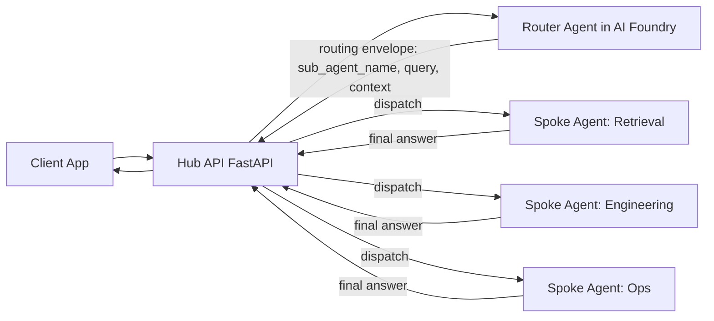

# AI Foundry Hub-and-Spoke Multi-Agent Infrastructure

This repository provisions a secure Azure foundation for a hub-and-spoke multi-agent system using Terraform.

The core idea is:
- The Hub exposes a FastAPI endpoint.
- The Hub forwards user intent to a Router Agent in Azure AI Foundry.
- The Router Agent decides which spoke sub-agent should handle the request and returns routing details to the Hub: `sub_agent_name`, `query`, and `context`.
- The Hub forwards the request to the selected spoke, which processes the task and returns a final response to the Hub.

## Why This Repository Exists

This project is designed to be published as a free, public reference implementation for teams that want to:
- Build enterprise-ready multi-agent systems
- Keep control-plane concerns separated from domain-agent concerns
- Use private networking, managed identities, and policy-first Azure architecture
- Reuse infrastructure modules across environments

## Repository Structure

- Root Terraform stack:
  - `main.tf`, `variables.tf`, `outputs.tf`, `providers.tf`, `backend.tf`
- Environment values:
  - `environments/dev.tfvars`
- Modules:
  - `modules/vnet`: network segmentation, private DNS, NAT, bastion subnet
  - `modules/keyvault`: secrets store for platform and workloads
  - `modules/monitoring`: Log Analytics + Application Insights
  - `modules/acr`: private Azure Container Registry
  - `modules/ai_foundry`: AI Foundry Hub/Project + AI Services + storage
  - `modules/ai_search`: Azure AI Search for retrieval-enabled spokes
  - `modules/identity`: platform identity for Foundry hub/project
  - `modules/aks_identity`: workload identity for AKS spokes
  - `modules/aks`: private AKS cluster for hub and spoke services
  - `modules/cosmosdb`: conversation/state persistence
  - `modules/redis`: low-latency cache/session support
  - `modules/devops_identity`, `modules/devops`: CI/CD build agents (optional path)
- Pipelines:
  - `pipelines/0-unified.yml` (staged Terraform plan/apply orchestration)

## Logical Request Flow



## Recommended Architecture Practices

### 1. Use a Strong Route Contract

Do not use free-text routing decisions from the Router Agent. Use a typed JSON envelope and validate it in the Hub before dispatch.

Suggested route envelope:

```json
{
  "sub_agent_name": "retrieval_spoke",
  "query": "summarized or rewritten task for the selected spoke",
  "context": {
    "user_intent": "knowledge_lookup",
    "conversation_id": "abc-123",
    "constraints": ["cite_sources"]
  },
  "confidence": 0.92,
  "fallback_agent": "generalist_spoke",
  "safety_flags": ["none"],
  "trace_id": "trace-xyz"
}
```

### 2. Apply Confidence-Based Routing

- High confidence: route directly to `sub_agent_name`.
- Medium confidence: route with additional Hub validation rules.
- Low confidence: use `fallback_agent` or return a clarification prompt.

### 3. Keep the Hub as the Policy Enforcement Point

The Hub should always enforce governance before and after spoke execution:
- authentication and authorization
- rate limiting and abuse controls
- prompt-injection and safety checks
- output schema validation and optional redaction

### 4. Build Observability at Route and Spoke Levels

Track route quality and runtime health separately:
- router latency and confidence distribution
- spoke latency and error rate by agent
- fallback frequency
- user feedback and quality score by spoke
- end-to-end request trace correlation with `trace_id`

### 5. Design for Safe Failure

- enforce timeout budgets per hop (Hub -> Router -> Spoke)
- add retries with backoff for transient failures
- use circuit breakers per spoke dependency
- return deterministic fallback responses

### 6. Version and Evaluate Continuously

- version router prompts and spoke prompts independently
- maintain route-accuracy datasets from real traffic traces
- run regression evaluation before promoting new router or spoke versions
- gate releases on quality and safety thresholds

### 7. Clarify Responsibility Boundaries

- Router Agent returns routing metadata only (`sub_agent_name`, `query`, `context`, confidence).
- Spoke Agent returns the final domain response.
- Hub owns orchestration, policy, and response normalization.

## Azure Building Blocks in This Stack

- Network and isolation:
  - Private endpoints + private DNS zones for key services
  - Segmented subnets for AKS, private endpoints, DevOps, and Bastion
- Identity and least privilege:
  - User-assigned managed identities for platform and workload layers
  - Explicit role assignments for Key Vault, ACR, AI Search, and Cosmos DB
- AI platform:
  - AI Foundry Hub and Project resources (via `azapi`)
  - AI Services connection bound into Foundry workspace
- Runtime and data services:
  - AKS for hosting hub and spoke services
  - Cosmos DB + Redis + AI Search for state, caching, and retrieval

## White Paper

A full white paper draft is included at:
- `docs/white-paper-ai-foundry-hub-spoke.md`

A publishing checklist is included at:
- `docs/github-publishing-checklist.md`

## Recommended Next Steps

1. Finalize the Hub API and Router Agent contract (request schema, route schema, error schema).
2. Add runnable sample code for Hub and one spoke agent.
3. Add architecture diagram images to support the white paper.
4. Publish with MIT license and a public roadmap.
