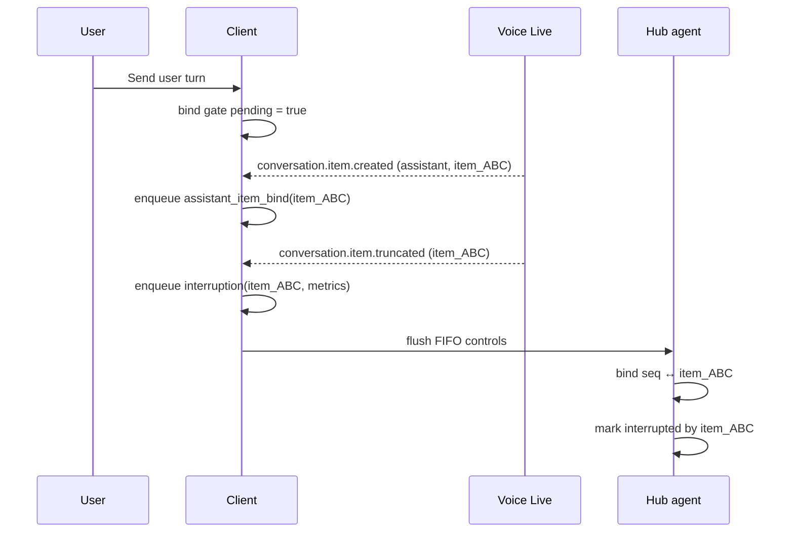

# Hub Agent — Voice Live API Invocation (POC)

A minimal React + TypeScript client that connects to **Azure AI Voice Live** in
**Foundry Agent mode**, streams microphone audio, plays agent audio, and renders
the hub agent's custom metadata that is delivered as a
`response.invocation.delta` passthrough event.

This document captures **exactly** what was required to make the hub agent's
`hubagent.metadata` reach the client, the versions involved, and how to run it.

---

## Hub HTTP invocation contract

The hub in [`../agents/hub`](../agents/hub) now serves **only `invocations`**
(`POST /invocations`), not `responses` or `invocations_ws`. The browser continues
to connect to Voice Live using its existing Foundry Agent configuration; Voice
Live calls the hub over HTTP. Redeploy the hub so its protocol declaration and
`voiceLiveCompatible: "true"` metadata take effect.

Accepted JSON bodies include:

```json
{"type":"input_audio.transcription","input":"Check my card"}
{"input":"Check my card"}
{"type":"response.create","response":{"invoke_input":{"text":"Check my card","context":{"channel":"web"}}}}
{"query":"Check my card"}
```

`invokeInput` is also accepted. Reuse `agent_session_id` in the invocation query
string (or the platform's `FOUNDRY_AGENT_SESSION_ID`) for multi-turn history.
The host resolves the session and returns it in `x-agent-session-id`; this
transport session takes precedence over `session_id` in the JSON body.

Responses are `text/event-stream`, with each JSON event framed as
`data: <JSON>\n\n`:

1. `hubagent.conversation` identifies the session; it is sent immediately.
2. `output_audio_transcription.delta` events carry **only the domain answer
   text**, forwarded chunk by chunk as the domain agent generates it.
3. `output_audio_transcription.done` contains the completed answer in `text`.
4. `hubagent.metadata` contains routing details, timings, usage and tool results.
5. `done` terminates the invocation.

Voice Live synthesizes speech from the transcription events and forwards custom
hub events to the browser as `response.invocation.delta`. The HTTP hub must not
wrap its transcript events in that envelope or speak the serialized
`QueryResponse` JSON.

### Streaming from domain agents

The hub classifies the intent first (one model call), then calls the selected
domain agent with `stream: true` over the Responses protocol:

- The domain agent streams its answer as normal `output_text` deltas, which the
  hub forwards immediately as `output_audio_transcription.delta`.
- After the text, the domain agent sends one **reasoning item** whose text is
  `{"domain_metadata": {...}}` (agent, confidence, tool results, token usage).
  The hub reads it into `hubagent.metadata`; it is never spoken. A reasoning item
  is used because the hosting adapter drops custom fields and usage otherwise.
- Non-streaming calls to a domain agent still return the full `QueryResponse`
  JSON, and the hub still accepts that legacy reply from agents not yet
  redeployed (it is held back and only its `response` text is spoken).
- If the domain stream fails after text was spoken, the turn ends with the text
  already streamed; if it fails before any text, a short error message is spoken.

Speech can therefore start once routing finishes and the domain model emits its
first tokens, instead of after the whole answer. `FORWARD_MODE=local` still uses
the non-streaming call. In a Foundry Playground, a streamed domain agent shows
the metadata as a reasoning item.

The app's `assistant_item_bind` and `interruption` controls are accepted as
wrapped, flattened, or JSON-encoded `input`/`text` payloads. They update assistant
message metadata in the hub's **in-memory session history**, emit no speech, and
end with `done`. Unlike the reference sample, this hub does not persist controls
or conversations to Cosmos DB. History is lost on restart and limited to the
most recent turns. Unknown events, invalid controls and empty turns emit
`hubagent.event.rejected` followed by `done`; malformed JSON/non-object HTTP
bodies return HTTP 400.

Run the focused checks from the hub directory with:

```powershell
.\.venv\Scripts\python.exe -m unittest discover -s tests -v
```

The historical reference-sample notes below describe its Cosmos-backed behavior,
not persistence guarantees of this hub.

---

## What this app does

- Connects to a Foundry **hosted agent** (`hub-agent`) over Voice Live using the
  `@azure/ai-voicelive` JS SDK.
- Sends mic audio (PCM16 @ 24 kHz) and plays back the agent's audio.
- Sends text turns via `response.create`.
- Renders the hub agent's custom UI metadata event
  (`{ type: "hubagent.metadata", data: {...} }`), which Voice Live wraps inside a
  `response.invocation.delta` server event.

The sibling reference client `frontend_v2` implements the same passthrough and
was used as the authoritative template. Both clients now behave identically.

---

## Versions (verified)

### Client (this POC and `frontend_v2`)

| Component                | Version            | Notes                                                            |
| ------------------------ | ------------------ | ---------------------------------------------------------------- |
| `@azure/ai-voicelive`    | `1.1.0-beta.1`     | Client JS SDK. **Identical** in both clients.                    |
| `@azure/core-auth`       | `^1.10.1`          | `TokenCredential` / `KeyCredential` types.                       |
| `react` / `react-dom`    | `^18.3.1`          |                                                                  |
| `typescript`             | `^5.9.2`           |                                                                  |
| `vite`                   | `^5.4.10`          | Dev server. **Reads `.env` only at startup** (see Gotchas).      |
| **Voice Live api-version** | `2026-06-01-preview` | Set via `VITE_VOICE_LIVE_API_VERSION` in `.env`. Both clients run this. |

### Agent (`hub-agent`)

| Component                        | Version         | Notes                                              |
| -------------------------------- | --------------- | -------------------------------------------------- |
| `azure-ai-voicelive`             | `>=1.3.0b1`     | Server-side Voice Live SDK (bumped from `>=1.0.0b1`). |
| `azure-ai-agentserver-invocations` | unpinned      | Provides the invocation/passthrough surface.       |
| `agent-framework-core`           | `1.2.2`         |                                                    |
| `agent-framework-foundry`        | `1.2.2`         |                                                    |
| `agent-framework-openai`         | `1.2.2`         |                                                    |
| `agent-framework-foundry-hosting`| `1.0.0a260429`  |                                                    |
| `azure-identity`                 | `1.25.3`        |                                                    |
| `azure-cosmos`                   | `>=4.9.0`       |                                                    |

The agent redeploys via CI/CD. It emits `hubagent.metadata` on the **welcome
turn** (immediately after the session starts, before any user input), and again
on subsequent turns as appropriate.

---

## The problem we solved

The hub agent's `hubagent.metadata` (wrapped by Voice Live as
`response.invocation.delta`) **never reached this POC**, even though the sibling
`frontend_v2` client received it with an identical SDK and api-version.

### Root causes (both had to be correct)

1. **Handler-registration timing.**
   The SDK's `startSession(target, { sessionHandlers })` subscribes the provided
   handlers **before** it opens the socket (`connect()`), and it does **not**
   replay events received before a subscription exists. The agent emits the
   welcome-turn `response.invocation.delta` the instant the session starts, so
   handlers must be registered up front.

   - ✅ Correct (both clients now): pass handlers via `sessionHandlers` in
     `startSession`.
   - ❌ Broken (old POC): call `session.subscribe(...)` *after* `startSession`
     and `updateSession` — the welcome metadata had already arrived and was
     dropped.

   Verified in the SDK source
   `node_modules/@azure/ai-voicelive/dist/esm/client/voiceLiveClient.js`
   (`startSession` calls `session.subscribe(...)` then `await session.connect()`).

2. **Configuration parity via `.env`.**
   `frontend_v2` had a checked-in `.env` pinning
   `VITE_VOICE_LIVE_API_VERSION=2026-06-01-preview` and the correct endpoints.
   This POC had **no `.env`** and fell back to code defaults. Adding an identical
   `.env` aligned the api-version, endpoints, agent name, and resource override.

### Secondary fixes (required for a stable connection)

3. **Minimal `session.update` payload.**
   In Foundry Agent mode the hosted agent controls `modalities`, `voice`, and
   audio formats. Sending those fields in `session.update` makes the server
   reject the update and close the socket (and/or reroutes responses through the
   realtime-model path, suppressing the passthrough). Send **only**:

   ```ts
   await session.updateSession({
     turnDetection: {
       type: "azure_semantic_vad",
       interruptResponse: true,
       autoTruncate: true,
     },
     metadata: {
       debug_logging: "true",
       token_timeout_seconds: "60",
     },
   });
   ```

4. **Correct session cleanup.**
   The SDK `VoiceLiveSession` exposes `disconnect()` and `dispose()` but **not**
   `close()`. The old POC called `session.close?.()` — a silent no-op. Cleanup
   now uses `await session.dispose()`.

5. **Robust delta parsing.**
   `response.invocation.delta`'s `delta` can arrive as an object **or** as a JSON
   string (optionally prefixed with the SSE marker `data: `). Parsing now
   normalizes both forms (`normalizeInvocationDelta`), matching `frontend_v2`.

---

## The exact working pattern

```ts
const client = new VoiceLiveClient(
  normalizeEndpoint(voiceLiveEndpoint),      // wss:// -> https://, host only
  new StaticTokenCredential(token, ttlMs),   // bearer token credential
  { apiVersion: DEFAULT_API_VERSION },       // 2026-06-01-preview (from .env)
);

const agent = {
  agentName: "hub-agent",
  projectName: extractProjectName(projectEndpoint),
  foundryResourceOverride,                   // optional
};

// 1. Handlers declared BEFORE the socket opens.
const sessionHandlers = {
  onSessionCreated, onSessionUpdated,
  onResponseAudioDelta,                      // PCM16 playback
  onResponseAudioTranscriptDelta, onResponseAudioTranscriptDone,
  onResponseTextDelta, onResponseTextDone,
  onConversationItemInputAudioTranscriptionCompleted,
  onServerError, onError,
  onServerEvent,                             // <-- catches response.invocation.delta
};

// 2. startSession subscribes handlers, THEN connects (captures welcome turn).
const session = await client.startSession({ agent }, { sessionHandlers });

// 3. Minimal update: turn detection + metadata only.
await session.updateSession({
  turnDetection: { type: "azure_semantic_vad", interruptResponse: true, autoTruncate: true },
  metadata: { debug_logging: "true", token_timeout_seconds: "60" },
});
```

### Handling the passthrough in `onServerEvent`

```ts
onServerEvent: async (event) => {
  if (event?.type === "response.invocation.delta") {
    const inner = normalizeInvocationDelta(event.delta); // object OR "data: {...}"
    if (inner && inner.type === "hubagent.metadata") {
      setAgentMetadata(parseMetadata(inner.data) ?? null);
    }
    return;
  }
  // ...surface everything else
};
```

---

## Control actions: `assistant_item_bind` and `interruption`

The client sends two control invocations so the hub can maintain accurate
conversation state in Cosmos without speaking extra turns.

### Purpose

- `assistant_item_bind` links the Voice Live assistant `item_id` to the latest
  unbound persisted assistant message.
- `interruption` marks that same assistant message as interrupted and stores
  barge-in metrics (`spokenChars`, `totalChars`, `audioFirstMs`, `elapsedMs`).

Without `assistant_item_bind`, interruption would have to guess "latest
assistant message," which can be wrong when turns overlap.

### Exactly when bind is sent

1. The client marks bind as pending whenever a new user turn is staged:
   - voice transcription completed path
   - typed input `sendMessage` path
2. Voice Live emits `onConversationItemCreated` for an assistant item.
3. If all are true, the client enqueues one bind:
   - `role === "assistant"`
   - `itemId` is present
   - `pending === true`
   - `itemId` has not been seen before

The gate is then consumed (`pending = false`) and the `itemId` is recorded in a
set for de-dup.

### How it relates to interruption

When the user barges in, Voice Live emits `conversation.item.truncated` for the
same assistant `item_id`. The client builds an interruption payload using that
`item_id` and enqueues an `interruption` control invocation.

Because both controls are enqueued in the same FIFO queue, bind is normally
sent before interruption for a given assistant item:



### Why controls are queued

Voice Live can reject sideband sends while a response is active
(`conversation_already_has_active_response`). The queue defers control
invocations and flushes after `response.done`, preserving order and avoiding
lost control updates.

## Voice Live Event Flow (End-to-End)

This is the runtime lifecycle used by this POC for text and voice turns.

### Flow overview

1. User input creates a user turn.
2. Client sends `conversation.item.create`.
3. Client sends `response.create`.
4. Server emits response and item events.
5. Client binds the first assistant item for that turn.
6. Client handles streaming text and audio.
7. Client handles completion (or interruption).

### Assistant bind gate

The bind gate tracks:

- `pending: boolean`
- `seenAssistantItemIds: Set<string>`

Rules:

1. `pending` becomes `true` when a new user turn is initiated.
2. On `conversation.item.created`, binding is allowed only when:
   - role is `assistant`
   - item id exists
   - `pending` is `true`
   - item id is not in `seenAssistantItemIds`
3. On first successful bind in that turn:
   - `pending` becomes `false`
   - item id is added to `seenAssistantItemIds`
   - `assistant_item_bind` is sent/enqueued

Why this matters:

- Prevents recursion where bind-triggered activity creates another assistant
  item that would otherwise be rebound repeatedly.
- Guarantees one bind per user turn.

### Normal text turn

1. User clicks Send (text).
2. Client sets bind gate `pending = true`.
3. Client posts user message (`conversation.item.create`).
4. Client opens response (`response.create`).
5. `response.created` arrives and response tracking resets.
6. First assistant `conversation.item.created` arrives and bind runs once.
7. Text/audio deltas stream.
8. `response.done` arrives and deferred control invocations flush.

### Normal voice turn

Voice uses the same turn semantics as text, with transcription completion as
the input source.

1. Transcript is finalized.
2. Client sets bind gate `pending = true`.
3. Client sends `conversation.item.create`.
4. Client sends `response.create`.
5. Remaining lifecycle is identical to text flow.

### Interrupted turn (barge-in)

While assistant audio is active, the client tracks turn-level state:

- `responseStartRef`
- `firstAudioAtRef`
- `assistantTranscriptRef`
- `scheduledAudioMsRef`

On `conversation.item.truncated`:

1. Client marks the response as truncated.
2. Client stops playback.
3. Client builds interruption payload from tracked refs.
4. Client enqueues `interruption` control.
5. Client clears response tracking to avoid duplicate reporting.

### Transport notes

- Uses `VoiceLiveClient` session handlers.
- Uses a control invocation queue to avoid active-response conflicts.
- Sends `assistant_item_bind` and `interruption` via the queued control path.

### Disconnect reset

On disconnect/close, the client resets:

- assistant bind gate (`pending = false`, seen set cleared)
- response active state
- interruption-tracking refs

This guarantees the next session starts clean.

---

## Implementation Notes

### Configuration and API version

The app reads `VITE_VOICE_LIVE_API_VERSION` from `.env`, matching `frontend_v2` exactly.
Code fallback is `"2026-04-10"`, but the checked-in `.env` sets it to `"2026-06-01-preview"` —
the version both clients actually run on.

### Playback context creation

Create the playback `AudioContext` before connecting the session. This ensures an output
target is ready the instant the welcome turn's audio arrives after `connect()`.

### Handler registration timing (critical)

Handlers **must** be registered before the socket opens via `sessionHandlers` in `startSession()`.
The SDK subscribes handlers *before* calling `connect()`, so the welcome turn's `response.invocation.delta`
(the `hubagent.metadata` passthrough, emitted the instant the agent session starts) is captured.

Late registration via `session.subscribe()` after `connect()` misses early events because the SDK
does not replay events received before a subscription exists.

### Invocation delta parsing

`response.invocation.delta` events carry a `delta` field that may arrive as either:
- An already-parsed object
- A JSON string (optionally prefixed with the SSE marker `"data: "`)

Normalize both forms before inspecting `type` to ensure robust event handling.

### Control invocation staging

When sending control actions (`assistant_item_bind`, `interruption`), stage the control JSON
as the latest conversation item. This prevents Voice Live from falling back to stale user text
(e.g., the OTT bootstrap payload) when the control handler returns no chat content.

### Barge-in bookkeeping

Track barge-in state on refs (not React state) so the `conversation.item.truncated` handler
reads exact, synchronous values at the instant of interruption:

- `responseStartRef` — when the response started playing
- `firstAudioAtRef` — when audio playback first began
- `assistantTranscriptRef` — the full assistant text heard so far
- `scheduledAudioMsRef` — the total scheduled audio duration (for latency estimation)

### Active response state

`responseActiveRef` tracks whether Voice Live has an open response. A barge-in causes Voice Live
to open its own response for the user's speech, so the client must not open a competing one
(it is rejected with `conversation_already_has_active_response`).

### Control flush delay

After `response.done`, defer the control flush by ~50ms before sending bind/interruption.
The server briefly needs time to transition out of the active-response state. Without this delay,
Voice Live rejects control invocations with `conversation_already_has_active_response` because
the `response.done` event and new `response.create` (for control) race.

### Session update payload

In Foundry agent mode, the hosted agent controls `modalities`, `voice`, and audio formats.
Send **only** `turnDetection` + `metadata` in `session.updateSession()`. Sending audio-format
or modality fields causes the server to reject the update and close the socket.

### Assistant bind gate

The gate prevents recursion:

1. User sends message → `pending = true`
2. Response creates assistant item
3. Check gate: `pending && role==assistant && !seen` → send bind
4. After bind: `pending = false`
5. Next assistant item won't bind

### Passthrough events

The hosted hub agent emits custom events (like `hubagent.metadata` and `hubagent.conversation`)
which Voice Live wraps as `response.invocation.delta` with the original event verbatim in `delta`.
Surface any server event with full payload to ensure nothing is hidden.

---

Environment variables (see `.env` / `.env.example`):

| Variable                                | Value (working)                                                                 |
| --------------------------------------- | ------------------------------------------------------------------------------- |
| `VITE_VOICE_LIVE_ENDPOINT`              | `wss://ai-rtag-agenthubspoke-dev-gwc.services.ai.azure.com/voice-live/realtime`  |
| `VITE_VOICE_LIVE_API_VERSION`           | `2026-06-01-preview`                                                             |
| `VITE_TOKEN_TIMEOUT_SECONDS`            | `60`                                                                             |
| `VITE_VOICE_LIVE_DEBUG_LOGGING`         | `true`                                                                           |
| `VITE_FOUNDRY_PROJECT_ENDPOINT`         | `https://ai-agenthubspoke-dev-gwc.services.ai.azure.com/api/projects/proj-agenthubspoke-dev-gwc` |
| `VITE_EXPECTED_AGENT_NAME`              | `hub-agent`                                                                      |
| `VITE_FOUNDRY_RESOURCE_OVERRIDE_DEFAULT`| `ai-agenthubspoke-dev-gwc`                                                     |

A bearer token is pasted into the UI at runtime (not stored in `.env`).

---

## Running

```powershell
npm install
npm run dev
```

Then open http://localhost:5173/, paste a bearer token, and click **Connect**.

On the **welcome turn** (before sending anything) you should see, in the event
log:

```
Server event: response.invocation.delta ...
HubAgent metadata: {"action":"selection", ...}
```

and the **HubAgent Metadata** card populates — matching `frontend_v2`.

---

## Gotchas

- **Vite reads `.env` only at startup.** HMR will *not* pick up `.env` changes —
  restart `npm run dev` after editing `.env`.
- **Don't add `modalities`/`voice`/audio-format fields to `session.update`** in
  Foundry Agent mode — the server rejects the update and closes the socket.
- **Register handlers via `sessionHandlers` in `startSession`**, never via a late
  `session.subscribe()` — early events are not replayed.
- **Use `session.dispose()` for cleanup**, not `session.close()` (which does not
  exist on the SDK session).

---

## Change summary

| Change                                                        | File                                  |
| ------------------------------------------------------------- | ------------------------------------- |
| Register handlers via `sessionHandlers` in `startSession`     | `src/App.tsx`                         |
| Move `updateSession` after `startSession`, minimal payload    | `src/App.tsx`                         |
| Cleanup: `close()` → `dispose()`                              | `src/App.tsx`                         |
| Robust `normalizeInvocationDelta` (object or `data:` string)  | `src/App.tsx`                         |
| Add `.env` matching `frontend_v2` (api-version + endpoints)   | `.env`, `.env.example`                |
| Client SDK pinned to `1.1.0-beta.1`                           | `package.json`                        |
| Agent SDK bumped `azure-ai-voicelive` `>=1.0.0b1` → `>=1.3.0b1` | `hub-agent/requirements.txt` |
</content>
