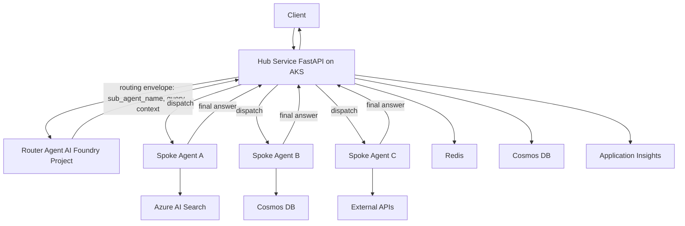

# White Paper Draft

## AI Foundry Hub and Spoke Design Pattern for Multi-Agent Systems

Version: 0.1 (Draft)
Date: 2026-04-18

## Abstract

Enterprise multi-agent systems often fail when orchestration logic, domain logic, and infrastructure concerns are tightly coupled. This white paper presents an Azure AI Foundry hub-and-spoke design pattern where a Hub service (FastAPI) receives user requests, delegates intent classification and routing to a Router Agent in AI Foundry, and then dispatches to domain-specific spoke agents for final response generation.

The pattern enables separation of concerns, secure-by-default networking, identity-first access, and repeatable infrastructure as code for production readiness.

## Problem Statement

Modern AI applications require multiple specialized agents (retrieval, operations, code, policy, analytics). A single monolithic agent tends to degrade in:
- Explainability of decisions
- Operational reliability under mixed workloads
- Governance and access control per domain
- Team autonomy and release velocity

A hub-and-spoke pattern addresses this by centralizing ingress and routing while decentralizing domain execution.

## Design Goals

- Clear control plane and data plane boundaries
- Deterministic routing with auditable agent decisions
- Least-privilege access for each runtime component
- Private network posture for platform services
- Scalable spoke execution and independent lifecycle
- Observable end-to-end request traces

## Reference Architecture

### Logical View



### Infrastructure Mapping (This Repository)

- Hub runtime:
  - AKS module for private cluster hosting (`modules/aks`)
- Router Agent platform:
  - AI Foundry Hub and Project (`modules/ai_foundry`)
- Shared data and tools:
  - AI Search (`modules/ai_search`)
  - Cosmos DB (`modules/cosmosdb`)
  - Redis (`modules/redis`)
- Security and access:
  - Platform identity for Foundry (`modules/identity`)
  - Workload identity for AKS (`modules/aks_identity`)
  - Key Vault (`modules/keyvault`)
- Network isolation:
  - VNet, private endpoints, private DNS (`modules/vnet`)
- Operations:
  - Monitoring with Log Analytics and App Insights (`modules/monitoring`)

## Request Lifecycle

1. Client sends request to Hub `/chat` endpoint.
2. Hub validates input, user context, and policy headers.
3. Hub calls Router Agent with normalized task payload.
4. Router returns a routing envelope, for example:
  - `sub_agent_name`
  - `query`
  - `context`
   - `confidence`
  - `fallback_agent`
   - `safety_flags`
  - `trace_id`
5. Hub enforces policy checks against returned route.
6. Hub invokes the selected spoke agent.
7. Spoke fetches data and tools as required.
8. Spoke returns final answer to Hub.
9. Hub post-processes (redaction, schema normalization, citations).
10. Hub returns response to client and writes telemetry.

## Recommended Architecture Practices

### 1. Use a Strong Route Contract

Do not use free-text routing decisions from the Router Agent. Use a typed JSON envelope and validate it in the Hub before dispatch.

Suggested route envelope:

```json
{
  "sub_agent_name": "retrieval_spoke",
  "query": "summarized or rewritten task for the selected spoke",
  "context": {
    "user_intent": "knowledge_lookup",
    "conversation_id": "abc-123",
    "constraints": ["cite_sources"]
  },
  "confidence": 0.92,
  "fallback_agent": "generalist_spoke",
  "safety_flags": ["none"],
  "trace_id": "trace-xyz"
}
```

### 2. Apply Confidence-Based Routing

- High confidence: route directly to `sub_agent_name`.
- Medium confidence: route with additional Hub validation rules.
- Low confidence: use `fallback_agent` or return a clarification prompt.

### 3. Keep the Hub as the Policy Enforcement Point

The Hub should always enforce governance before and after spoke execution:
- authentication and authorization
- rate limiting and abuse controls
- prompt-injection and safety checks
- output schema validation and optional redaction

### 4. Build Observability at Route and Spoke Levels

Track route quality and runtime health separately:
- router latency and confidence distribution
- spoke latency and error rate by agent
- fallback frequency
- user feedback and quality score by spoke
- end-to-end request trace correlation with `trace_id`

### 5. Design for Safe Failure

- enforce timeout budgets per hop (Hub -> Router -> Spoke)
- add retries with backoff for transient failures
- use circuit breakers per spoke dependency
- return deterministic fallback responses

### 6. Version and Evaluate Continuously

- version router prompts and spoke prompts independently
- maintain route-accuracy datasets from real traffic traces
- run regression evaluation before promoting new router or spoke versions
- gate releases on quality and safety thresholds

### 7. Clarify Responsibility Boundaries

- Router Agent returns routing metadata only (`sub_agent_name`, `query`, `context`, confidence).
- Spoke Agent returns the final domain response.
- Hub owns orchestration, policy, and response normalization.

## Router Contract Design

A strongly typed routing contract reduces ambiguity and runtime failures.

Example response schema:

```json
{
  "sub_agent_name": "retrieval_spoke",
  "query": "summarized or rewritten task for the selected spoke",
  "context": {
    "user_intent": "knowledge_lookup",
    "conversation_id": "abc-123",
    "constraints": ["cite_sources"]
  },
  "confidence": 0.92,
  "fallback_agent": "generalist_spoke",
  "safety_flags": ["none"],
  "trace_id": "trace-xyz"
}
```

## Hub API Contract (FastAPI)

Suggested minimal interfaces:
- `POST /chat`: end-user request entry point
- `POST /route`: internal endpoint for route simulation/testing
- `GET /healthz`: liveness probe
- `GET /readyz`: readiness probe
- `GET /metrics`: Prometheus/OpenTelemetry export

Minimal pseudo-code:

```python
@app.post("/chat")
async def chat(request: ChatRequest):
    route = await router_agent.route(request)
    enforce_policy(route, request)
  spoke = spoke_registry.resolve(route.sub_agent_name)
    result = await spoke.handle(request, route)
    return normalize_response(result)
```

## Security Model

### Identity

- Use user-assigned managed identity for AI Foundry platform operations.
- Use separate user-assigned managed identity for AKS workloads.
- Assign only required roles:
  - Key Vault Secrets User
  - AcrPull
  - Search Index Data Contributor
  - Cosmos DB SQL Data Contributor

### Network

- Use private endpoints for AI Services, Storage, Key Vault, Cosmos DB, Redis, ACR, and Search.
- Use private DNS zones linked to workload VNet.
- Keep AKS private and avoid public control plane exposure.

### Secrets and Configuration

- Keep keys and connection metadata in Key Vault.
- Prefer managed identity over static secrets.
- Rotate and audit all credentials that cannot be eliminated.

## Reliability and Scalability

- Scale hub and spokes independently.
- Add timeout budgets and retry policy per spoke.
- Use circuit breakers for unstable downstream dependencies.
- Define deterministic fallback routing when router confidence is low.
- Cache repeated retrieval workloads with Redis.

## Observability and Evaluation

Capture at least these telemetry dimensions:
- Route decision latency
- Spoke execution latency
- Router confidence distribution
- Route mismatch rate (offline adjudication)
- User feedback score by agent
- Safety intervention counts

Evaluation recommendations:
- Build route-accuracy datasets from real traces.
- Run periodic regression tests when prompts or models change.
- Track quality by route, not only aggregate chatbot metrics.

## Governance and Operating Model

- Platform team owns hub framework, router policy, and infra baseline.
- Domain teams own spoke prompts, tools, and domain evaluation sets.
- Release spoke agents independently with contract tests.
- Version routing policy separately from spoke behavior.

## Common Anti-Patterns

- Treating router output as untrusted free text instead of typed JSON.
- Sharing one identity across hub, router, and all spokes.
- Running without route-level observability.
- Hard-coding route rules in multiple services.
- No fallback route for uncertain intent.

## Implementation Roadmap

1. Phase 1: Core platform
   - Deploy Terraform modules and validate private networking.
2. Phase 2: Hub and router integration
   - Implement FastAPI Hub and route contract.
3. Phase 3: Initial spokes
   - Add retrieval spoke and operations spoke.
4. Phase 4: Evaluation
   - Build route and answer quality benchmark datasets.
5. Phase 5: Production hardening
   - SLOs, autoscaling, canary rollout, and incident playbooks.

## Conclusion

The AI Foundry hub-and-spoke pattern provides a practical architecture for scaling multi-agent systems safely. By separating ingress, routing, and domain execution, organizations can improve governance, reliability, and team velocity without sacrificing model agility.

## Appendix A: Suggested Figures for Publication

- Figure 1: Logical architecture (Hub, Router, Spokes)
- Figure 2: Sequence diagram of request lifecycle
- Figure 3: Identity and RBAC boundary diagram
- Figure 4: Private endpoint and DNS topology
- Figure 5: Evaluation loop (trace -> dataset -> benchmark -> prompt update)

## Appendix B: Suggested Audience

- Enterprise architects
- Platform engineers
- AI engineering leads
- Security and governance stakeholders
