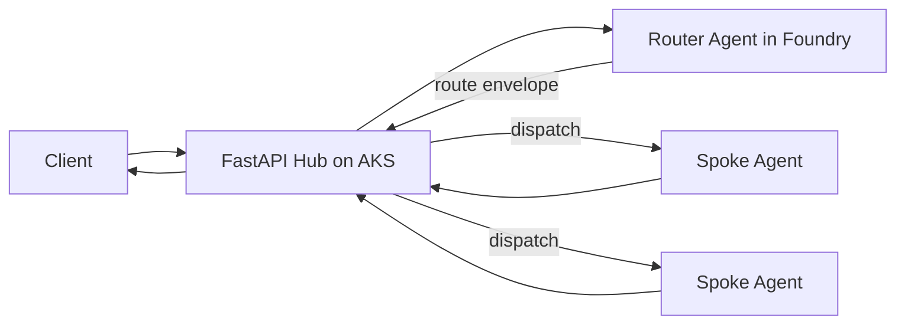
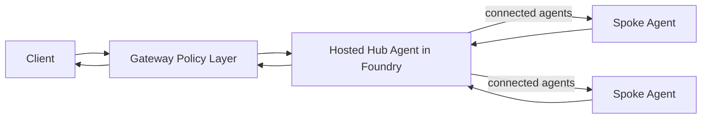

# White Paper

## AI Foundry Hub-and-Spoke Multi-Agent Architecture

### Comparative Review of Two Hub Implementations and Production Readiness Guidance

Version: 1.0  
Date: 2026-07-02  
Prepared from: DESIGN_REVIEW.md, infrastructure/README.md, infrastructure/README-hosted-hub-agent.md

## Executive Summary

This paper consolidates three source documents into a single decision guide for implementing a Hub-and-Spoke multi-agent architecture on Azure AI Foundry.

The repository presents two viable Hub implementation models:

1. FastAPI Hub on AKS (code-owned orchestration and policy gate)
2. Hosted Router Hub Agent in Foundry Agent Service (platform-managed orchestration)

Both designs are architecturally strong and align with modern enterprise patterns. However, the design review identifies critical controls required before production use in regulated domains such as banking, especially around authentication, authorization, PII protection, immutable audit, routing guardrails, and encryption.

Key conclusion:
- Choose FastAPI Hub when deterministic governance and strict policy enforcement are top priorities.
- Choose Hosted Hub Agent when minimizing operational footprint and accelerating delivery are top priorities.
- For high-regulation workloads, implement a policy-grade ingress/gateway and the hardening controls in this paper regardless of Hub model.

## Scope and Method

This white paper synthesizes:
- Architectural intent and infrastructure baseline from infrastructure/README.md.
- Alternate hosted-hub pattern from infrastructure/README-hosted-hub-agent.md.
- Security and compliance gap assessment from DESIGN_REVIEW.md.

The output is a practical guide with:
- Side-by-side architecture comparison.
- Deployment and operating model guidance.
- Risk and control mapping.
- A phased hardening roadmap.

## Problem Statement

Single-agent systems often struggle to scale safely across multiple business domains. A Hub-and-Spoke pattern introduces specialization while preserving centralized governance:
- Hub: orchestration, routing, policy, normalization.
- Spokes: domain execution and domain tools.

The challenge is deciding where the Hub should live:
- As an application you own (FastAPI on AKS).
- As a managed orchestrator (Foundry hosted agent).

## Architecture Baseline from the Repository

The shared platform baseline is Terraform-driven and private-first:
- Private networking with VNet segmentation, private endpoints, and private DNS.
- Identity separation with user-assigned managed identities for platform, workloads, and CI/CD.
- Foundry Hub/Project, AI Services, optional Realtime, AI Search, Cosmos DB, Redis, Key Vault, ACR, and monitoring.
- Pipeline staging for init, network, devops, core, and destroy, with private agent pool sequencing for private vault operations.

## The Two Hub Implementations

### Implementation A: FastAPI Hub on AKS

The Hub runs as a service you control.

Typical flow:
1. Client calls Hub API.
2. Hub normalizes request and enforces policy checks.
3. Hub requests route intent from Router Agent.
4. Hub validates routing envelope and dispatches to selected spoke.
5. Hub post-processes and returns final response.

Strengths:
- Deterministic, code-owned enforcement point.
- Flexible custom controls before and after route/spoke execution.
- Deep observability and explicit operational control.

Trade-offs:
- Higher operational responsibility (runtime, scaling, deployment, patching).
- More code to maintain.
- Requires disciplined security hardening.

### Implementation B: Hosted Router Hub Agent in Foundry

The Hub is a hosted agent in Agent Service.

Typical flow:
1. Client request enters through thin ingress gateway.
2. Hosted Hub Agent performs route selection and delegation via connected agents.
3. Selected spoke executes and returns final response through the Hub Agent.
4. Gateway returns validated response to client.

Strengths:
- Smaller control-plane surface.
- Faster adoption of native Foundry orchestration patterns.
- Built-in thread and tracing primitives.

Trade-offs:
- Model-driven routing requires stronger contract validation.
- Governance cannot depend on prompt behavior alone.
- Requires externalized policy gate for regulated workloads.

## Side-by-Side Comparison

| Concern | FastAPI Hub on AKS | Hosted Router Hub Agent |
| --- | --- | --- |
| Hub runtime | App-managed service | Foundry Agent Service |
| Routing implementation | Deterministic code + model input | Model-driven structured output |
| Policy enforcement | In Hub code | In thin ingress/gateway |
| Operational footprint | Higher | Lower |
| Customization depth | Highest | High, with platform boundaries |
| State ownership | App-owned (Cosmos/Redis) | Foundry threads plus optional data stores |
| Compliance control posture | Strong when implemented correctly | Strong only with explicit gateway controls |
| Time to initial delivery | Moderate | Fast |
| Best fit | Regulated or high-control systems | Rapid scaling with managed orchestration |

## Recommended Route Contract

Both implementations should enforce a typed route envelope.

```json
{
  "sub_agent_name": "retrieval_spoke",
  "query": "rewritten task for selected spoke",
  "context": {
    "user_intent": "knowledge_lookup",
    "conversation_id": "abc-123",
    "constraints": ["cite_sources"]
  },
  "confidence": 0.92,
  "fallback_agent": "generalist_spoke",
  "safety_flags": ["none"],
  "trace_id": "trace-xyz"
}
```

Routing policy guidance:
- High confidence: direct route.
- Medium confidence: route with extra policy checks.
- Low confidence: fallback or clarification prompt.

## Security and Compliance Findings (from Design Review)

The reviewed implementation quality is strong in architecture and observability, but not production-ready for banking without additional controls.

Critical gaps identified:
1. Authentication and authorization validation not enforced end-to-end.
2. Input sanitization and sensitive-data detection insufficient.
3. PII redaction/masking in telemetry not guaranteed.
4. Immutable audit trail for sensitive operations missing.
5. Rate limiting and anomaly/fraud signaling not fully implemented.
6. Routing decision hardening against jailbreak/policy bypass required.
7. Session data persistence/encryption strategy insufficient for regulated workloads.
8. Prompt guardrails for high-risk operations not comprehensive.

Implication:
- Architecture is a solid foundation.
- Production release in regulated contexts should be gated by security and compliance hardening.

## Control Framework for Both Hub Models

### Identity and Access

- Validate user identity tokens at ingress and workload boundaries.
- Enforce role and scope checks before route and tool execution.
- Isolate identities across hub, spokes, and platform services.

### Data Protection

- Detect and redact sensitive fields in input, logs, traces, and outputs.
- Encrypt persisted conversational/session data with managed keys.
- Minimize data retention and separate operational logs from audit logs.

### Policy and Safety

- Validate route schema and whitelist allowed target agents.
- Apply prompt-injection detection and output validation.
- Require step-up confirmation for sensitive operations.

### Audit and Monitoring

- Record immutable, tamper-evident audit events for sensitive actions.
- Track per-hop latency, fallback rate, route confidence, and safety interventions.
- Correlate telemetry and audit events with trace_id and user/session IDs.

### Runtime Hardening

- Use non-root containers, health probes, and explicit resource policies.
- Apply timeout budgets, retries with backoff, and circuit breakers.
- Establish SLOs and alert thresholds by route and spoke.

## Decision Framework

Choose FastAPI Hub on AKS when:
- You need deterministic policy enforcement in code.
- You need custom governance logic at every hop.
- You can support a larger operational footprint.

Choose Hosted Router Hub Agent when:
- You want faster delivery with managed orchestration.
- You can place a robust gateway in front of Foundry.
- Your team prefers reducing application runtime ownership.

Choose hybrid governance when:
- You want hosted orchestration with strict enterprise controls.
- You place an API gateway/policy facade in front of the hosted hub.

## Reference Flows

### Flow A: FastAPI Hub



### Flow B: Hosted Hub Agent



## Deployment and Operations Notes

From the repository implementation:
- First-run sequencing is essential (init first, permissions, private agent availability, then core).
- Private Key Vault operations should run from private agents after network path is available.
- P2S VPN plus private DNS is required for local private endpoint testing.

Operationally important guidance:
- Keep public exposure limited to required edge/control points (for example, Bastion, NAT egress identity, VPN gateway ingress).
- Apply least privilege to deployment and runtime identities.
- Review network and role assignments periodically to prevent drift.

## Phased Hardening Roadmap

Phase 1: Security baseline (target 4-6 weeks)
- Token validation and RBAC enforcement.
- Input validation and sensitive data controls.
- Route envelope validation and allowed-agent checks.

Phase 2: Compliance baseline (target 3-4 weeks)
- Immutable audit logging for sensitive actions.
- Telemetry redaction and retention policy controls.
- Encryption and key management for persisted state.

Phase 3: Runtime hardening (target 2-3 weeks)
- Container hardening and probe policies.
- Capacity and timeout tuning.
- Alerting and incident playbooks.

Phase 4: Assurance and release (target 3-4 weeks)
- Penetration and abuse-path testing.
- Route-quality and safety regression gates.
- Production readiness sign-off.

## Final Recommendations

1. Keep the typed route contract as a non-negotiable interface in both models.
2. Treat the policy gate as mandatory, not optional, for regulated workloads.
3. Prioritize security and compliance controls before feature expansion.
4. Select Hub model based on governance needs first, operational preference second.
5. Use this repository infrastructure baseline to standardize private-first deployments and identity separation.

## Conclusion

The reviewed architecture is strong and extensible. The two Hub implementations are both valid, but they optimize for different priorities:
- FastAPI Hub optimizes for deterministic control.
- Hosted Hub Agent optimizes for managed simplicity.

With the control framework and hardening plan in this paper, either path can be evolved into an enterprise-ready multi-agent platform. For banking or similarly regulated domains, production readiness depends on implementing security, data protection, auditability, and governance controls as first-class release gates.

## Appendix: Source Documents Reviewed

- DESIGN_REVIEW.md
- infrastructure/README.md
- infrastructure/README-hosted-hub-agent.md
