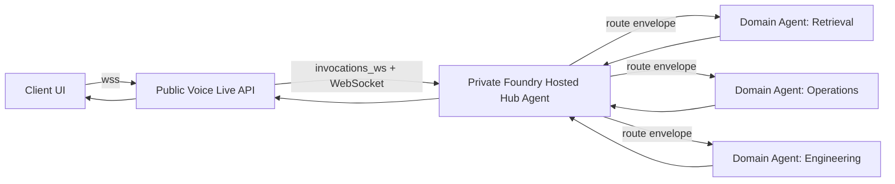
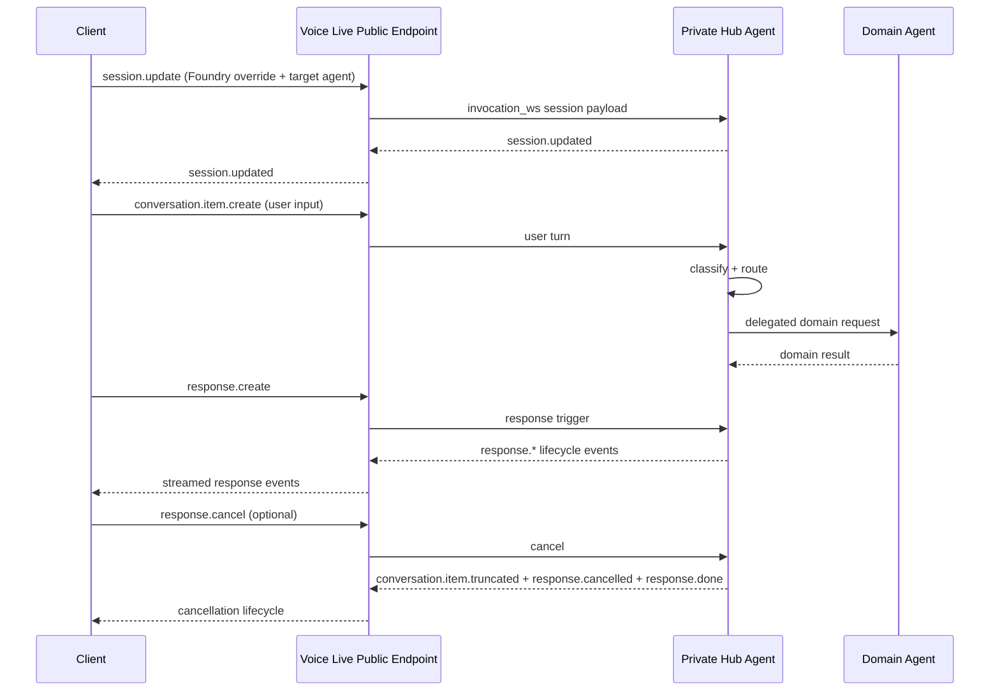

# White Paper: Voice Live Public Ingress to Private Foundry Hub-and-Spoke Agents

## Executive Summary

This paper documents the Proof of Concept (PoC) in `poc_voice_live_api_agent` for a real-time, multi-agent architecture that combines:

- A public Azure AI Foundry Voice Live API endpoint for client-facing voice and text interaction.
- A private Azure AI Foundry hosted hub agent as the orchestration layer.
- Hub-and-spoke routing to domain agents for domain-specific execution.
- Real-time transport over `invocations_ws` WebSocket protocol.

The PoC validates that a public Voice Live ingress can carry session and conversation events to a private hosted agent endpoint, where orchestration logic can classify user intent, route to specialized domain agents, and return unified responses through the same real-time channel.

## Problem Statement

Enterprise AI systems often need both:

- Low-friction public real-time user interaction.
- Strict private execution boundaries for orchestration, tool access, and data-sensitive workflows.

A single-agent design can become a bottleneck as domain breadth grows (support, operations, engineering, retrieval, compliance, and others). This PoC addresses that by separating concerns:

- Public Voice Live handles user session transport.
- Private Hub agent handles orchestration and routing.
- Domain agents handle specialized execution.

## Goals and Non-Goals

### Goals

- Demonstrate real-time end-to-end flow from public Voice Live to private Foundry hub agent.
- Use `invocations_ws` protocol with deterministic event handling.
- Support interruption-aware interaction (`response.cancel`, truncation events, barge-in behavior).
- Establish a hub-and-spoke pattern where the hub delegates to domain agents.

### Non-Goals

- Production-grade autoscaling and full SLO hardening.
- Full STT/TTS pipeline fidelity in local-only test mode.
- Complete domain-agent tool catalog implementation in this PoC folder.

## Reference Implementation Scope

The implementation is centered in:

- `poc_voice_live_api_agent/frontend`
- `poc_voice_live_api_agent/hub_agent`

Key runtime artifacts:

- `poc_voice_live_api_agent/hub_agent/agent.yaml`: hosted agent manifest, declares `invocations_ws` and WebSocket transport path `/voice-live/realtime`.
- `poc_voice_live_api_agent/hub_agent/voice_live_host.py`: WebSocket host built on `InvocationAgentServerHost`.
- `poc_voice_live_api_agent/hub_agent/hub_agent.py`: event dispatcher and session/response state machine.
- `poc_voice_live_api_agent/hub_agent/prompts/hub_prompt.txt`: deterministic router prompt contract.

## Target Architecture



## Logical Control Plane and Data Plane

- Ingress Plane:
  - Public Voice Live endpoint accepts client WebSocket connections.
  - Session bootstrap carries Foundry project and target agent metadata.
- Orchestration Plane:
  - Private hosted hub agent receives invocation events through `invocations_ws`.
  - Hub classifies intent, chooses domain route, and coordinates downstream execution.
- Domain Execution Plane:
  - Domain agents execute specialized tasks with private resources and policies.
- Egress Plane:
  - Hub returns normalized response events through Voice Live to the client.

## Protocol and Event Model

The PoC uses a Voice Live event lifecycle with deterministic handling.

Typical event order:

1. `session.update`
2. `conversation.item.create`
3. `response.create`
4. (optional interruption) `response.cancel`
5. response lifecycle events (`response.created`, `response.output_item.*`, `response.done`)

The hub implementation enforces interruption-friendly behavior:

- `turn_detection.interrupt_response = true`
- `turn_detection.auto_truncate = true`

These settings allow barge-in scenarios where an in-flight response is cancelled and truncated safely.

## Hub Agent Responsibilities

The hub agent in this PoC is designed as a deterministic orchestration boundary.

Responsibilities:

- Maintain per-connection session and conversation state.
- Dispatch inbound Voice Live event types to explicit handlers.
- Start, track, and cancel in-flight responses.
- Produce a structured routing decision.
- Coordinate downstream domain execution and normalize response output.

Current prompt contract in `hub_prompt.txt` requires JSON-only output with:

- `target_route`
- `action`
- `confidence`
- `rationale`

This makes routing decisions machine-parseable and safer to validate.

## Hub-to-Domain Agent Delegation Pattern

A recommended route envelope for domain-agent dispatch is:

```json
{
  "sub_agent_name": "retrieval_spoke",
  "query": "rewritten task for selected domain",
  "context": {
    "conversation_id": "abc-123",
    "user_intent": "knowledge_lookup"
  },
  "confidence": 0.92,
  "fallback_agent": "generalist_spoke"
}
```

Routing policy guideline:

- High confidence: direct dispatch.
- Medium confidence: dispatch with additional checks.
- Low confidence: fallback agent or clarification request.

## End-to-End Sequence



## Security and Trust Boundaries

### Public Boundary

- Client traffic enters via public Voice Live endpoint.
- Client authentication can use token-based or key-based mode according to environment controls.

### Private Boundary

- Hub agent is hosted in private Foundry context.
- Domain agent tools and data dependencies stay in private networked services.

### Identity and Access

- Managed identity is used by the hub runtime for Azure resource access.
- Least-privilege role assignment is required for Foundry, search, storage, and data services.

### Governance Controls

- Validate route envelopes before dispatch.
- Enforce allowlist of domain agent names.
- Log route confidence, fallback frequency, and error categories.

## Deployment and Operations

The PoC supports:

- Local runtime for functional testing.
- Hosted runtime for private Foundry deployment.

Operational guidance:

- Keep a strict schema for route responses.
- Add timeout budgets for hub and domain-agent hops.
- Implement deterministic fallback behavior.
- Capture tracing IDs across public ingress, hub, and spokes.

## Testing Strategy

### Local Functional Tests

- WebSocket manual or scripted sequence using:
  - `session.update`
  - `conversation.item.create`
  - `response.create`
  - `response.cancel` (for interruption path)

### Interruption/Resilience Tests

- Verify cancellation emits:
  - `conversation.item.truncated`
  - `response.cancelled`
  - `response.done`

### Multi-Agent Routing Tests

- Build a route test set with expected `sub_agent_name` outcomes.
- Track route accuracy, fallback rate, and mean latency.

## Key Findings from the PoC

- `invocations_ws` is suitable for low-latency, event-driven hub orchestration.
- Structured route output is critical for safe multi-agent delegation.
- Interruption handling is a first-class requirement in voice-first UX.
- A private hub with domain spokes offers a practical balance between scale and control.

## Limitations and Next Steps

Current PoC limitations:

- Local audio path is protocol-compatible but does not implement full local STT.
- Domain-agent wiring depth can be expanded for richer enterprise scenarios.
- Production-grade observability dashboards and route-quality evaluation are not fully packaged in this folder.

Recommended next steps:

1. Implement explicit connected-agent registry and route allowlist.
2. Add route contract validation middleware and confidence thresholds.
3. Add automated routing evaluation datasets and regression tests.
4. Add end-to-end distributed tracing with correlation IDs.
5. Define SLOs per spoke (latency, error budget, fallback ratio).

## Conclusion

This PoC demonstrates a viable enterprise pattern: public real-time Voice Live ingress connected to a private Foundry hub agent that orchestrates specialized domain agents. The architecture preserves user-facing responsiveness while keeping orchestration and domain execution in controlled private boundaries. With route validation, policy controls, and observability hardening, this pattern can scale from PoC to production multi-agent platforms.
