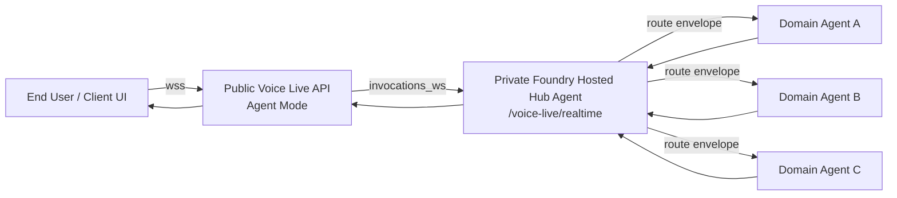
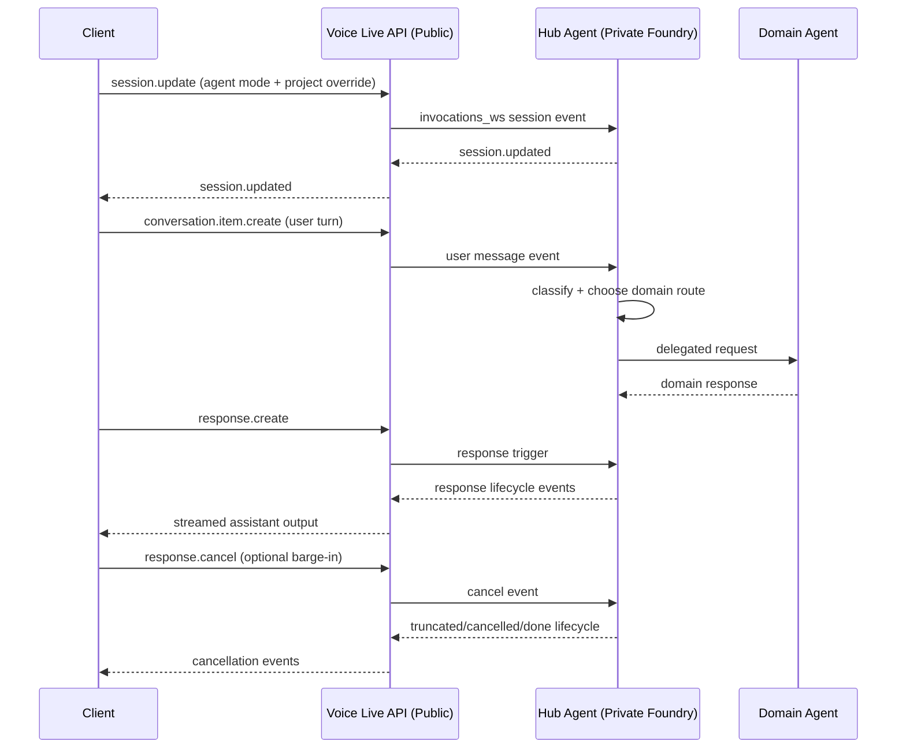

# White Paper

## Public Voice Live Agent Mode to Private Foundry Hub-and-Spoke Multi-Agent PoC

Version: 1.0  
Date: 2026-07-05

## Introduction

This white paper describes the Proof of Concept (PoC) in `poc_voice_live_api_agent`. The architecture uses a public Azure AI Foundry Voice Live API endpoint in agent mode for user interaction, while orchestration and domain execution remain in a private Azure AI Foundry hub-and-spoke model.

The business reason for this design is to solve a common enterprise conflict:

- business teams want fast, natural, real-time voice and chat experiences for users,
- security and compliance teams require private execution boundaries, controlled identities, and governed data access,
- and platform teams need a scalable model that can expand to multiple business domains without rewriting the entire assistant stack.

In many organizations, a single-agent pattern becomes a bottleneck. As use cases expand across support, operations, knowledge retrieval, and internal workflows, one agent becomes harder to govern, harder to test, and slower to evolve. This increases delivery risk, operational risk, and cost.

This PoC addresses that business case by separating responsibilities:

- the public Voice Live layer provides low-latency user session transport,
- the private hub agent provides centralized orchestration and policy-aware routing,
- domain agents provide specialized execution that can scale per business capability.

The practical outcome we are trying to achieve is a production-oriented blueprint where user experience quality, governance requirements, and delivery speed can coexist. In short, this architecture is designed to reduce time-to-value for new AI capabilities while maintaining enterprise control over data, identity, and operational risk.

## Contents

1. Understanding the Components of the PoC
2. Our Target Architecture
3. The Infrastructure Foundation
3.1 Virtual Network
3.2 Key Vault
3.3 Monitoring
3.4 Azure Container Registry
3.5 Storage
3.6 Cosmos DB and Redis
3.7 Azure AI Foundry and AI Services
3.8 Azure AI Search
3.9 AKS and Workload Identities
3.10 DevOps Build Agent
4. Deployment with Azure DevOps and CI/CD
5. Hub Agent Runtime and Request Flow
6. Security and Trust Boundaries
7. Testing and Validation
8. Limitations and Next Steps
9. Conclusion

## 1. Understanding the Components of the PoC

The PoC is built from two main application areas:

- `poc_voice_live_api_agent/frontend`: the client application that is hosted on AKS and connects to the Voice Live websocket endpoint.
- `poc_voice_live_api_agent/hub_agent`: the hosted hub agent implementation that runs in private Azure AI Foundry.

The hub agent runtime is defined by:

- `poc_voice_live_api_agent/hub_agent/agent.yaml`
- `poc_voice_live_api_agent/hub_agent/azure.yaml`
- `poc_voice_live_api_agent/hub_agent/main.py`
- `poc_voice_live_api_agent/hub_agent/hub_agent.py`
- `poc_voice_live_api_agent/hub_agent/voice_live_host.py`

The important runtime contract is simple:

- AKS hosts the frontend UI and websocket client,
- public Voice Live handles session transport,
- private hub agent handles routing and orchestration,
- domain agents handle domain-specific work.

## 2. Our Target Architecture

The target architecture is a hub-and-spoke pattern with a public ingress and a private orchestration layer.



In this design:

- the public endpoint is only the interaction surface,
- the hub agent is the private decision-maker,
- and each spoke agent is responsible for a specific domain or task type.

## 3. The Infrastructure Foundation

The platform is provisioned with Terraform from the root stack and a set of reusable modules. The infrastructure is intentionally layered so that network, identity, and private access are in place before the AI services and workloads are used.

### 3.1 Terraform Build Model

The root stack is defined in:

- `main.tf`
- `variables.tf`
- `providers.tf`
- `backend.tf`

Environment-specific values come from:

- `environments/dev.tfvars`
- `environments/prd.tfvars`

The deployment creates a workload resource group and then composes the rest of the environment through modules.

### 3.2 Virtual Network

The virtual network is the base of the private architecture.

`modules/vnet` provides:

- subnet segmentation,
- private DNS zones,
- DNS resolver support,
- Bastion subnet support,
- and the address structure for private endpoints.

This network is the backbone for keeping storage, AI services, Key Vault, Cosmos DB, Redis, and search private.

### 3.3 Key Vault

`modules/keyvault` provides the secret store used by the platform and workloads.

It is designed to support:

- private endpoint access,
- identity-based access control,
- and secret isolation for deployment and runtime identities.

This is where deployment secrets and runtime values are kept out of the public path.

### 3.4 Monitoring

`modules/monitoring` provisions the observability baseline:

- Log Analytics,
- Application Insights,
- and private endpoint integration where needed.

This gives the platform a place to collect traces, metrics, and diagnostics for the hub, the spokes, and the surrounding infrastructure.

### 3.5 Azure Container Registry

`modules/acr` creates the private container registry used for image distribution.

It supports private endpoint access and is the source of container images for any workloads that need them, including AKS-hosted components and internal services.

### 3.6 Storage

`modules/storage` provides the private storage account used by AI workloads and supporting assets.

The storage account is used for artifacts and data that need to remain on private network paths.

### 3.7 Cosmos DB and Redis

Two supporting data services provide persistence and low-latency state handling:

- `modules/cosmosdb` for conversation and state persistence.
- `modules/redis` for cache and session acceleration.

These services allow the hub and spokes to keep conversational or workflow state without relying on the client session alone.

### 3.8 Azure AI Foundry and AI Services

`modules/ai_foundry` provisions the Foundry hub/project foundation and the AI Services layer.

The identity and platform support modules around it include:

- `modules/ai_foundry_identity`
- `modules/ai_foundry_voiceliveapi_model_mode`
- `modules/ai_foundry_voiceliveapi_agent_mode`

For this PoC, the key runtime is the agent-mode Voice Live setup, which exposes the websocket transport path and connects to the private hub agent.

### 3.9 Azure AI Search

`modules/ai_search` is the retrieval layer for knowledge-oriented domain agents.

When a spoke needs retrieval, the hub can route to an agent that uses search as its domain-specific execution engine.

### 3.10 AKS and Workload Identities

`modules/aks` and `modules/aks_identity` support private containerized workloads and workload identity patterns.

In this PoC, AKS is required to host the frontend application that connects to the public Voice Live websocket endpoint. From there, the frontend bridges user interaction into the hub-agent over `invocations_ws`.

While the hub agent itself is hosted in Foundry, AKS remains available for any private container-based spokes or services that the broader architecture may require.

#### 3.10.1 AKS Frontend Deployment Path

The frontend is deployed as a containerized web application on AKS, which gives the PoC a private, managed runtime for the client UI.

The deployment path is typically:

1. Build the frontend image and publish it to the private container registry.
2. Deploy the frontend workload to AKS using the cluster identity and registry access.
3. Expose the frontend through the cluster service or ingress layer.
4. Serve the UI to the user from AKS.
5. Have the UI open a websocket connection to the public Voice Live API endpoint.
6. Let Voice Live forward the real-time session to the private hub-agent over `invocations_ws`.

This means AKS is not the orchestration layer. It is the host for the browser-facing frontend, while the public Voice Live API remains the websocket bridge into the private Foundry hub-agent.

#### 3.10.2 Ingress Recommendation

For this PoC, the recommended default ingress option is **NGINX Ingress**.

Why:

- It is the simplest path for exposing the AKS-hosted frontend and works well with websocket traffic.
- It keeps the deployment lightweight, which matches a PoC focused on proving the Voice Live and hub-agent flow.
- It avoids introducing additional Azure platform complexity before the architecture is production-hardened.

Use **Application Gateway for Containers** if you want a more Azure-native long-term ingress layer with stronger managed integration and future production emphasis.

Use **AGIC** only if the environment already has an existing Application Gateway and you want to reuse that investment. For a new build, it is not the preferred choice.

### 3.11 DevOps Build Agent

`modules/devops_identity` and `modules/devops` provision the private build agent infrastructure used by the CI/CD path.

This is important because private-only operations, especially those involving Key Vault or private resources, should be performed from a trusted private build context.

### 3.12 Point-to-Site VPN for Local Private Access

The PoC uses an optional Point-to-Site VPN so a local PC can join the private Azure virtual network and reach private endpoints, including the private Foundry project path.

The VPN module is implemented in `modules/p2s_vpn` and creates:

- a `GatewaySubnet` inside the target virtual network,
- a public IP for the VPN gateway,
- an Azure VPN gateway configured for route-based OpenVPN,
- and Azure AD authentication for client access.

The VPN gateway is configured with:

- `vpn_client_protocols = ["OpenVPN"]`
- `vpn_auth_types = ["AAD"]`
- a client address pool defined by `p2s_vpn_client_address_space`

When the VPN is enabled in the environment tfvars, the network pipeline includes `module.p2s_vpn[0]` during network provisioning.

Local setup flow:

1. Set `enable_p2s_vpn = true` in the environment tfvars file.
2. Provide `gateway_subnet_prefixes` and `p2s_vpn_client_address_space` values.
3. Apply the network and core Terraform stages.
4. In Azure Portal, open the Virtual Network Gateway and download the VPN client profile.
5. Install Azure VPN Client on the local PC.
6. Import the downloaded profile and sign in with the same Entra ID identity used for access.
7. Confirm that private DNS resolves private endpoint names while the VPN is connected.

This VPN path matters because private Foundry resources, Key Vault, AI Search, Cosmos DB, Storage, and other private endpoints are not intended to be accessed directly from the public internet.

#### 3.12.1 p2s_vpn Deployment

The `p2s_vpn` module is deployed as part of the network layer. It is optional and only created when `enable_p2s_vpn = true` in the selected environment tfvars file.

Deployment inputs required by the module are:

- `gateway_subnet_prefixes`: the CIDR block for the `GatewaySubnet`.
- `p2s_vpn_client_address_space`: the client address pool assigned to VPN users.
- `p2s_dns_servers`: the private DNS resolver IP pushed to clients so they can resolve private endpoint names.

The deployed resources are:

- `azurerm_subnet.gateway` named `GatewaySubnet`
- `azurerm_public_ip.vpn_gateway`
- `azurerm_virtual_network_gateway.p2s`

The VPN gateway is configured for:

- route-based VPN,
- OpenVPN client protocol,
- Azure AD authentication,
- and a client address range that does not overlap with the VNet or the local network.

The network pipeline includes `module.p2s_vpn[0]` automatically when the tfvars file enables VPN. That means P2S is deployed together with the VNet layer, not as a separate manual step.

Operationally, the deployment order is important:

1. Create the Terraform state backend.
2. Deploy the network layer with the `p2s_vpn` module enabled.
3. Deploy DevOps and core services.
4. Download the VPN client profile from the Azure Portal.
5. Import the profile into Azure VPN Client and sign in with Entra ID.
6. Validate that private DNS resolves private endpoints while connected.

## 4. Deployment with Azure DevOps and CI/CD

The deployment path is staged so that foundational resources are created before dependent services.

The primary orchestration is in:

- `pipelines/0-unified.yml`
- `pipelines/1-init.yml`
- `pipelines/2-network.yml`
- `pipelines/3-devops.yml`
- `pipelines/4-core.yml`
- `pipelines/5-destroy.yml`
- `pipelines/6-hub-agent-foundry.yml`

### 4.1 Deployment Sequence

The unified pipeline runs the environment in a deliberate order:

1. `TFStateInit` creates the Terraform backend resource group, storage account, and container.
2. `PlanNetwork` and `ApplyNetwork` build the virtual network, Bastion, and optional P2S VPN layer.
3. `PlanDevOps` and `ApplyDevOps` build the Key Vault, DevOps identity, and build agent layer.
4. `PlanCore` and `ApplyCore` deploy the core private services and AI platform components.

This order matters because the later services depend on network, identity, and private access being present first.

### 4.2 First Run Considerations

For a new environment, the first run often starts with core deployment disabled until the private build agent pool is online.

The sequence is typically:

1. Run the init and network stages.
2. Bring up the private DevOps agent pool.
3. Re-run with core deployment enabled.

This avoids failures when private-only actions need a private execution path.

### 4.3 Hosted Hub Agent Deployment

Once the infrastructure exists, the hosted hub agent is deployed with the Foundry descriptors in:

- `poc_voice_live_api_agent/hub_agent/azure.yaml`
- `poc_voice_live_api_agent/hub_agent/agent.yaml`

These define the hosted runtime, protocol, and websocket path for the private hub agent.

### 4.4 Local Developer Access to Private Foundry

After the VPN is connected, a local developer can use the private network path to access the Foundry project and related private services.

The practical validation steps are:

1. Connect the VPN.
2. Verify private DNS resolution for the private endpoint names.
3. Use local authentication or a private access token where appropriate.
4. Open the hosted hub-agent websocket endpoint through the private network path.
5. Test the end-to-end request flow from the local client.

If the VPN is not connected, the local PC should not be able to reach the private Foundry project or its private dependencies.

### 4.5 P2S VPN Deployment and Validation Checklist

When you deploy `p2s_vpn`, use this checklist to confirm it is ready for local access:

1. Confirm `enable_p2s_vpn = true` in the environment tfvars file.
2. Confirm `gateway_subnet_prefixes` is defined and large enough for `GatewaySubnet`.
3. Confirm `p2s_vpn_client_address_space` does not overlap with the VNet or any connected network.
4. Run the network pipeline and verify the VPN gateway is created.
5. Download the VPN client package from the Virtual Network Gateway page.
6. Import the package into Azure VPN Client on the local PC.
7. Connect using the same Entra ID tenant used by the deployment.
8. Validate private name resolution and access to private endpoints.
9. Confirm the private Foundry project and hosted hub-agent endpoint are reachable only over the VPN path.

## 5. Hub Agent Runtime and Request Flow

The hub agent is the orchestration center of the system. It receives the request over `invocations_ws`, parses the event stream, and decides how to route each request.

### 5.1 Event and State Management

The hub implementation follows an explicit event dispatcher and lifecycle model.

Primary event families include:

- `session.update`
- `conversation.item.create`
- `response.create`
- `response.cancel`
- `input_audio_buffer.*`

Primary outbound lifecycle events include:

- `response.created`
- `response.output_item.*`
- `response.done`
- `conversation.item.truncated`
- `response.cancelled`

The PoC is configured for interruption-aware behavior so voice users can barge in and cancel a response cleanly.

### 5.2 Hub-to-Domain Routing

The hub should not route using free text. It should produce a structured envelope that can be validated before dispatch.

```json
{
  "sub_agent_name": "domain_retrieval",
  "query": "rewritten domain-specific task",
  "context": {
    "conversation_id": "abc-123",
    "intent": "knowledge_lookup"
  },
  "confidence": 0.91,
  "fallback_agent": "domain_generalist"
}
```

Routing guidance:

- high confidence: direct dispatch,
- medium confidence: dispatch with validation,
- low confidence: fallback or clarification.

### 5.3 End-to-End Flow



## 6. Security and Trust Boundaries

The architecture is intentionally split between public ingress and private execution.

### Public Boundary

- Voice Live handles the external websocket session.
- Authentication is enforced before the session is allowed to progress.

### Private Boundary

- The hub and domain agents run in the private Foundry context.
- Tool and data access remain private and identity-governed.

### Identity and Access

- Managed identities are used for runtime components.
- Role assignments are scoped to the exact resources needed.
- Private-only secret operations are performed from the private execution path.

### Routing Safety

- Validate the route envelope schema.
- Enforce an allowlist of valid domain agent names.
- Track confidence, fallback rate, and routing failures.

## 7. Testing and Validation

The PoC supports both local validation and hosted deployment.

Local validation should cover:

- websocket session startup,
- request and response lifecycle handling,
- interruption and truncation behavior,
- and hub routing decisions.

Production-oriented validation should cover:

- route accuracy,
- response latency,
- fallback frequency,
- and private network access.

Operational recommendations:

- propagate correlation IDs through all events and logs,
- define SLOs for latency and error budget,
- and add regression datasets for routing quality.

## 8. Limitations and Next Steps

The PoC is intentionally scoped to prove the pattern, not to exhaust every enterprise feature.

Current limitations:

- domain-agent depth is still PoC-level,
- route-quality evaluation is not yet fully automated,
- and observability is not yet packaged into final dashboards.

Recommended next steps:

1. Introduce a strict connected-agent registry and route allowlist.
2. Add route-schema validation middleware before dispatch.
3. Add policy checks for sensitive task categories.
4. Build a routing benchmark dataset and CI regression gate.
5. Add distributed tracing across ingress, hub, and spokes.

## 9. Conclusion

This PoC demonstrates a practical enterprise pattern for real-time AI: a public Voice Live API in agent mode for interaction, a private Foundry hub for orchestration, and domain spokes for specialized execution. The architecture keeps the user experience responsive while preserving the control, privacy, and separation needed for serious multi-agent systems.