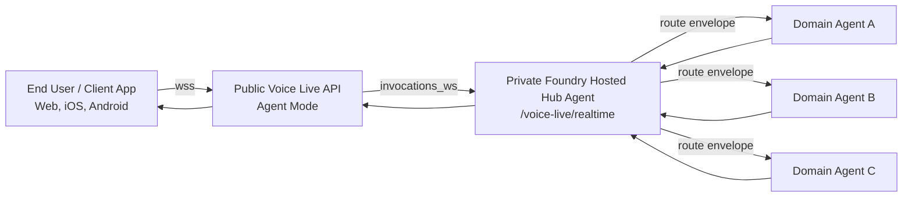
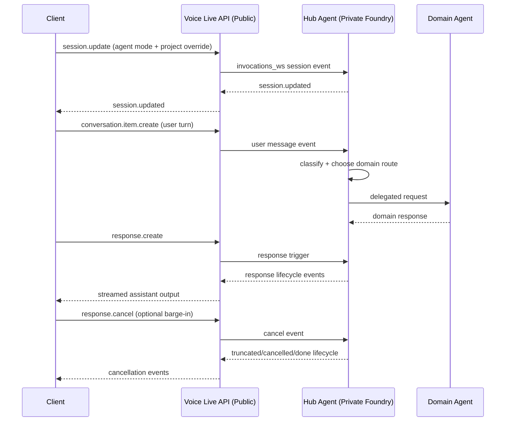

# White Paper

## Public Voice Live Agent Mode to Private Foundry Hub-and-Spoke Multi-Agent PoC

Version: 1.0  
Date: 2026-07-05

## Introduction

This white paper describes the Proof of Concept (PoC) in `poc_voice_live_api_agent`. The architecture uses a public Azure AI Foundry Voice Live API endpoint in agent mode for user interaction, while orchestration and domain execution remain in a private Azure AI Foundry hub-and-spoke model.

The business reason for this design is to solve a common enterprise conflict:

- business teams want fast, natural, real-time voice and chat experiences for users,
- security and compliance teams require private execution boundaries, controlled identities, and governed data access,
- and platform teams need a scalable model that can expand to multiple business domains without rewriting the entire assistant stack.

In many organizations, a single-agent pattern becomes a bottleneck. As use cases expand across support, operations, knowledge retrieval, and internal workflows, one agent becomes harder to govern, harder to test, and slower to evolve. This increases delivery risk, operational risk, and cost.

This PoC addresses that business case by separating responsibilities:

- the public Voice Live layer provides low-latency user session transport,
- the private hub agent provides centralized orchestration and policy-aware routing,
- domain agents provide specialized execution that can scale per business capability.

The practical outcome we are trying to achieve is a production-oriented blueprint where user experience quality, governance requirements, and delivery speed can coexist. In short, this architecture is designed to reduce time-to-value for new AI capabilities while maintaining enterprise control over data, identity, and operational risk.

## Contents

1. Understanding the Components of the PoC
2. Our Target Architecture
3. The Infrastructure Foundation
3.1 Terraform Build Model
3.2 Virtual Network
3.3 Key Vault
3.4 Monitoring
3.5 Azure Container Registry
3.6 Storage
3.7 Cosmos DB and Redis
3.8 Azure AI Foundry
3.9 Voice Live API Agent Mode
3.10 AI Foundry Identity
3.11 Azure AI Search
3.12 AKS and Workload Identities
3.13 DevOps Build Agent
3.14 Point-to-Site VPN for Local Private Access
4. Deployment with Azure DevOps and CI/CD
5. Hub Agent Runtime and Request Flow
6. Security and Trust Boundaries
7. Testing and Validation
8. Limitations and Next Steps
9. Conclusion

## 1. Understanding the Components of the PoC

The PoC is built from two main application areas:

- `poc_voice_live_api_agent/frontend`: a reference web client application hosted on AKS that connects to the Voice Live websocket endpoint. In the same architecture, the client can also be a native mobile app on iOS or Android.
- `poc_voice_live_api_agent/hub_agent`: the hosted hub agent implementation that runs in private Azure AI Foundry.

The hub agent runtime is defined by:

- `poc_voice_live_api_agent/hub_agent/agent.yaml`
- `poc_voice_live_api_agent/hub_agent/azure.yaml`
- `poc_voice_live_api_agent/hub_agent/main.py`
- `poc_voice_live_api_agent/hub_agent/hub_agent.py`
- `poc_voice_live_api_agent/hub_agent/voice_live_host.py`

The important runtime contract is simple:

- the client app (web, iOS, or Android) opens the realtime session,
- public Voice Live handles session transport,
- private hub agent handles routing and orchestration,
- domain agents handle domain-specific work.

## 2. Our Target Architecture

The target architecture is a hub-and-spoke pattern with a public ingress and a private orchestration layer.



  At a high level, the architecture has four distinct layers:

  - the **client layer**, which can be a web app or a native mobile app on iOS or Android,
  - the **public realtime ingress layer**, which is Azure AI Foundry Voice Live API in agent mode,
  - the **private orchestration layer**, which is the hosted hub agent running in private Foundry,
  - and the **domain execution layer**, which contains one or more spoke agents and supporting company systems.

  The design goal is to keep the user experience public and responsive while keeping the reasoning, policy enforcement, and enterprise integration inside the private boundary.

  ### 2.1 Client Layer

  The client is intentionally thin. It should handle:

  - user interaction,
  - realtime session setup,
  - message streaming,
  - and presentation of the final answer.

  The client should not contain business routing logic or direct access to internal company systems. It simply starts the conversation and receives the response stream.

  ### 2.2 Public Ingress Layer

  Voice Live API in agent mode is the public entry point for the realtime conversation.

  Its role is to:

  - terminate the public websocket session,
  - forward the session to the private hub agent,
  - preserve the realtime event contract,
  - and return streamed outputs back to the client.

  This layer is the transport bridge, not the business brain of the system.

  ### 2.3 Private Orchestration Layer

  The hosted hub agent is the central control point for the architecture.

  It is responsible for:

  - understanding the user intent,
  - deciding whether the request is conversational, retrieval-based, or action-based,
  - selecting the correct spoke agent or tool,
  - enforcing policy before delegation,
  - and shaping the final response.

  This is where the architecture gains governance. The hub is the place where the platform can apply routing rules, confidence thresholds, safety checks, and tool selection policies.

  ### 2.4 Domain Execution Layer

  The spoke agents and their connected business systems perform the specialized work.

  Examples include:

  - retrieval over enterprise knowledge sources,
  - customer or order lookups,
  - workflow actions,
  - compliance checks,
  - and domain-specific automation.

  Each spoke should own one narrow responsibility set. That keeps the system modular and makes it easier to add, test, and govern new capabilities without changing the entire assistant.

  ### 2.5 Why This Shape Works

  This architecture is useful because it separates the concerns that usually get mixed together in a single-agent design:

  - session transport stays public and simple,
  - reasoning and policy stay centralized,
  - and enterprise actions stay behind controlled tools or delegate agents.

  That separation lets the platform evolve in two directions at once: the client experience can stay fast and low-latency, while the enterprise integration and governance model can become more sophisticated over time.

In this design:

- the public endpoint is only the interaction surface,
- the hub agent is the private decision-maker,
- and each spoke agent is responsible for a specific domain or task type.

## 3. The Infrastructure Foundation

The platform is provisioned with Terraform from the root stack and a set of reusable modules. The infrastructure is intentionally layered so that network, identity, and private access are in place before the AI services and workloads are used.

### 3.1 Terraform Build Model

The root stack is defined in:

- `main.tf`
- `variables.tf`
- `providers.tf`
- `backend.tf`

Environment-specific values come from:

- `environments/dev.tfvars`
- `environments/prd.tfvars`

The deployment creates a workload resource group and then composes the rest of the environment through modules.

### 3.2 Virtual Network

The virtual network is the base of the private architecture.

`modules/vnet` provides:

- subnet segmentation,
- private DNS zones,
- DNS resolver support,
- Bastion subnet support,
- and the address structure for private endpoints.

This network is the backbone for keeping storage, AI services, Key Vault, Cosmos DB, Redis, and search private.

### 3.3 Key Vault

`modules/keyvault` provides the secret store used by the platform and workloads.

It is designed to support:

- private endpoint access,
- identity-based access control,
- and secret isolation for deployment and runtime identities.

This is where deployment secrets and runtime values are kept out of the public path.

### 3.4 Monitoring

`modules/monitoring` provisions the observability baseline:

- Log Analytics,
- Application Insights,
- and private endpoint integration where needed.

This gives the platform a place to collect traces, metrics, and diagnostics for the hub, the spokes, and the surrounding infrastructure.

### 3.5 Azure Container Registry

`modules/acr` creates the private container registry used for image distribution.

It supports private endpoint access and is the source of container images for any workloads that need them, including AKS-hosted components and internal services.

### 3.6 Storage

`modules/storage` provides the private storage account used by AI workloads and supporting assets.

The storage account is used for artifacts and data that need to remain on private network paths.

### 3.7 Cosmos DB and Redis

Two supporting data services provide persistence and low-latency state handling:

- `modules/cosmosdb` for conversation and state persistence.
- `modules/redis` for cache and session acceleration.

These services allow the hub and spokes to keep conversational or workflow state without relying on the client session alone.

### 3.8 Azure AI Foundry

`modules/ai_foundry` provisions the Foundry hub/project foundation and the AI Services layer.

This is the private AI control plane where the hosted hub agent and related AI project resources are anchored.

### 3.9 Voice Live API Agent Mode

The PoC uses the Voice Live API in agent mode as the public real-time ingress path.

This capability is provisioned through:

- `modules/voiceliveapi_agent_mode`
- `modules/voiceliveapi_model_mode`

For this architecture, the key runtime path is agent mode because it allows the realtime session to target the hosted hub-agent instead of a direct model-only interaction.

### 3.10 AI Foundry Identity

`modules/ai_foundry_identity` provisions the user-assigned identity and access model used by Foundry workloads.

This identity is what allows the private Foundry resources to authenticate to dependent Azure services such as Key Vault, Storage, AI Search, Cosmos DB, and other governed dependencies.

### 3.11 Azure AI Search

`modules/ai_search` is the retrieval layer for knowledge-oriented domain agents.

When a spoke needs retrieval, the hub can route to an agent that uses search as its domain-specific execution engine.

### 3.12 AKS and Workload Identities

`modules/aks` and `modules/aks_identity` support private containerized workloads and workload identity patterns.

In this PoC, AKS hosts a reference web frontend application that connects to the public Voice Live websocket endpoint. The same realtime contract can also be implemented by native iOS and Android apps, which connect to Voice Live and bridge user interaction into the hub-agent over `invocations_ws`.

While the hub agent itself is hosted in Foundry, AKS remains available for any private container-based spokes or services that the broader architecture may require.

#### 3.12.1 AKS Frontend Deployment Path

The reference frontend is deployed as a containerized web application on AKS, which gives the PoC a private, managed runtime for browser-based client UI.

The deployment path is typically:

1. Build the frontend image and publish it to the private container registry.
2. Deploy the frontend workload to AKS using the cluster identity and registry access.
3. Expose the frontend through Application Gateway for Containers in front of the cluster service.
4. Serve the UI to the user from AKS.
5. Have the UI open a websocket connection to the public Voice Live API endpoint.
6. Let Voice Live forward the real-time session to the private hub-agent over `invocations_ws`.

This means AKS is not the orchestration layer. It is the host for the browser-facing frontend, while the public Voice Live API remains the websocket bridge into the private Foundry hub-agent.

#### 3.12.2 Ingress Recommendation

For this PoC, the selected ingress option is **Application Gateway for Containers**.

Why:

- It provides an Azure-native ingress layer for exposing the AKS-hosted frontend.
- It is a better fit when the PoC is intended to evolve toward a more production-oriented platform architecture.
- It gives a cleaner path for managed ingress policy, traffic control, and future hardening than a minimal in-cluster ingress controller.

`NGINX Ingress` would still be a valid lighter-weight PoC option, but it is not the preferred choice for this implementation.

`AGIC` is only preferred when an existing Application Gateway footprint is already part of the target platform and the goal is to preserve that design.

### 3.13 DevOps Build Agent

`modules/devops_identity` and `modules/devops` provision the private build agent infrastructure used by the CI/CD path.

This is important because private-only operations, especially those involving Key Vault or private resources, should be performed from a trusted private build context.

### 3.14 Point-to-Site VPN for Local Private Access

In this PoC, Point-to-Site VPN is the local testing path to Azure AI Foundry private networking. A local PC must connect through P2S VPN to join the private Azure virtual network and reach private endpoints, including the private Foundry project path.

The VPN module is implemented in `modules/p2s_vpn` and creates:

- a `GatewaySubnet` inside the target virtual network,
- a public IP for the VPN gateway,
- an Azure VPN gateway configured for route-based OpenVPN,
- and Azure AD authentication for client access.

The VPN gateway is configured with:

- `vpn_client_protocols = ["OpenVPN"]`
- `vpn_auth_types = ["AAD"]`
- a client address pool defined by `p2s_vpn_client_address_space`

When the VPN is enabled in the environment tfvars, the network pipeline includes `module.p2s_vpn[0]` during network provisioning.

Local setup flow:

1. Set `enable_p2s_vpn = true` in the environment tfvars file.
2. Provide `gateway_subnet_prefixes` and `p2s_vpn_client_address_space` values.
3. Apply the network and core Terraform stages.
4. In Azure Portal, open the Virtual Network Gateway and download the VPN client profile.
5. Install Azure VPN Client on the local PC.
6. Import the downloaded profile and sign in with the same Entra ID identity used for access.
7. Confirm that private DNS resolves private endpoint names while the VPN is connected.

This VPN path is what enables AI Foundry testing from a local machine in a private-network design. Private Foundry resources, Key Vault, AI Search, Cosmos DB, Storage, and other private endpoints are not intended to be accessed directly from the public internet.

#### 3.14.1 p2s_vpn Deployment

The `p2s_vpn` module is deployed as part of the network layer. It is optional and only created when `enable_p2s_vpn = true` in the selected environment tfvars file.

Deployment inputs required by the module are:

- `gateway_subnet_prefixes`: the CIDR block for the `GatewaySubnet`.
- `p2s_vpn_client_address_space`: the client address pool assigned to VPN users.
- `p2s_dns_servers`: the private DNS resolver IP pushed to clients so they can resolve private endpoint names.

The deployed resources are:

- `azurerm_subnet.gateway` named `GatewaySubnet`
- `azurerm_public_ip.vpn_gateway`
- `azurerm_virtual_network_gateway.p2s`

The VPN gateway is configured for:

- route-based VPN,
- OpenVPN client protocol,
- Azure AD authentication,
- and a client address range that does not overlap with the VNet or the local network.

The network pipeline includes `module.p2s_vpn[0]` automatically when the tfvars file enables VPN. That means P2S is deployed together with the VNet layer, not as a separate manual step.

Operationally, the deployment order is important:

1. Create the Terraform state backend.
2. Deploy the network layer with the `p2s_vpn` module enabled.
3. Deploy DevOps and core services.
4. Download the VPN client profile from the Azure Portal.
5. Import the profile into Azure VPN Client and sign in with Entra ID.
6. Validate that private DNS resolves private endpoints while connected.

## 4. Deployment with Azure DevOps and CI/CD

The deployment path is staged so that foundational resources are created before dependent services.

The primary orchestration is in:

- `pipelines/0-unified.yml`
- `pipelines/1-init.yml`
- `pipelines/2-network.yml`
- `pipelines/3-devops.yml`
- `pipelines/4-core.yml`
- `pipelines/5-destroy.yml`
- `pipelines/6-hub-agent-foundry.yml`

### 4.1 Deployment Sequence

The unified pipeline runs the environment in a deliberate order:

1. `TFStateInit` creates the Terraform backend resource group, storage account, and container.
2. `PlanNetwork` and `ApplyNetwork` build the virtual network, Bastion, and optional P2S VPN layer.
3. `PlanDevOps` and `ApplyDevOps` build the Key Vault, DevOps identity, and build agent layer.
4. `PlanCore` and `ApplyCore` deploy the core private services and AI platform components.

This order matters because the later services depend on network, identity, and private access being present first.

### 4.2 First Run Considerations

For a new environment, the first run often starts with core deployment disabled until the private build agent pool is online.

The sequence is typically:

1. Run the init and network stages.
2. Bring up the private DevOps agent pool.
3. Re-run with core deployment enabled.

This avoids failures when private-only actions need a private execution path.

### 4.3 Hosted Hub Agent Deployment

Once the infrastructure exists, the hosted hub agent is deployed with the Foundry descriptors in:

- `poc_voice_live_api_agent/hub_agent/azure.yaml`
- `poc_voice_live_api_agent/hub_agent/agent.yaml`

These define the hosted runtime, protocol, and websocket path for the private hub agent.

### 4.4 Local Developer Access to Private Foundry

After the VPN is connected, a local developer can use the private network path to access the Foundry project and related private services.

For this PoC, P2S VPN is the required connectivity method from a local PC to test private Azure AI Foundry resources.

The practical validation steps are:

1. Connect the VPN.
2. Verify private DNS resolution for the private endpoint names.
3. Use local authentication or a private access token where appropriate.
4. Open the hosted hub-agent websocket endpoint through the private network path.
5. Test the end-to-end request flow from the local client.

If the VPN is not connected, the local PC should not be able to reach the private Foundry project or its private dependencies.

### 4.5 P2S VPN Deployment and Validation Checklist

When you deploy `p2s_vpn`, use this checklist to confirm it is ready for local access:

1. Confirm `enable_p2s_vpn = true` in the environment tfvars file.
2. Confirm `gateway_subnet_prefixes` is defined and large enough for `GatewaySubnet`.
3. Confirm `p2s_vpn_client_address_space` does not overlap with the VNet or any connected network.
4. Run the network pipeline and verify the VPN gateway is created.
5. Download the VPN client package from the Virtual Network Gateway page.
6. Import the package into Azure VPN Client on the local PC.
7. Connect using the same Entra ID tenant used by the deployment.
8. Validate private name resolution and access to private endpoints.
9. Confirm the private Foundry project and hosted hub-agent endpoint are reachable only over the VPN path.

## 5. Hub Agent Runtime and Request Flow

The hub agent is the orchestration center of the system. It receives the request over `invocations_ws`, parses the event stream, and decides how to route each request.

### 5.1 Event and State Management

The hub implementation follows an explicit event dispatcher and lifecycle model.

Primary event families include:

- `session.update`
- `conversation.item.create`
- `response.create`
- `response.cancel`
- `input_audio_buffer.*`

Primary outbound lifecycle events include:

- `response.created`
- `response.output_item.*`
- `response.done`
- `conversation.item.truncated`
- `response.cancelled`

The PoC is configured for interruption-aware behavior so voice users can barge in and cancel a response cleanly.

### 5.2 Hub-to-Domain Routing

The hub should not route using free text. It should produce a structured envelope that can be validated before dispatch.

```json
{
  "sub_agent_name": "domain_retrieval",
  "query": "rewritten domain-specific task",
  "context": {
    "conversation_id": "abc-123",
    "intent": "knowledge_lookup"
  },
  "confidence": 0.91,
  "fallback_agent": "domain_generalist"
}
```

Routing guidance:

- high confidence: direct dispatch,
- medium confidence: dispatch with validation,
- low confidence: fallback or clarification.

### 5.3 End-to-End Flow



  ### 5.4 How Agents Call Company APIs Through Tools

  The hub agent and spoke agents should not call business systems directly from arbitrary prompts. Instead, they should use a controlled tool layer that exposes approved company capabilities in a governed way.

  In practice, the flow is:

  1. The client sends a user request to the public Voice Live endpoint.
  2. Voice Live forwards the session to the private hub agent.
  3. The hub classifies the request and decides whether it should be answered from reasoning, retrieval, or a business action.
  4. If a business action is required, the hub selects the correct tool and passes a structured request to it.
  5. The tool executes the operation against the company API, MCP server, or agent-to-agent endpoint.
  6. The tool returns a normalized result to the hub.
  7. The hub formats the result into a user-facing response and sends it back through Voice Live.

  This keeps the architecture safe because the model never gets unrestricted access to enterprise systems. It only sees the tool contracts that the platform explicitly exposes.

  The recommended tool categories are:

  - **Direct API tools** for synchronous company operations such as lookup, create, update, and status checks.
  - **MCP tools** for discoverable, schema-driven integrations where the agent needs a standardized tool contract.
  - **A2A tools** for delegating a task to another specialized agent when the work is better handled by a separate agent boundary.

    #### 5.4.0 When the Hub Invokes a Spoke Agent vs Calls Tools Directly

    The hub should make this decision explicitly on every turn.

    Invoke a **spoke agent** when:

    - the request maps to a known domain capability,
    - domain-specific reasoning is required,
    - the task may involve multiple tool calls in sequence,
    - the task needs a separate policy or ownership boundary,
    - or the response should come from a domain-owned logic path.

    Call a **tool directly from the hub** when:

    - the operation is simple and cross-domain,
    - no deep domain reasoning is needed,
    - the response can be produced from a single controlled call,
    - and central platform ownership is preferred over domain delegation.

    Practical execution order:

    1. Hub classifies user intent and confidence.
    2. Hub checks route allowlist and policy gates.
    3. Hub chooses either:
      - direct tool path (hub -> tool), or
      - domain path (hub -> spoke -> tool[s]).
    4. If domain path is selected, the spoke performs domain reasoning and decides which tools to call.
    5. Spoke returns a structured domain result to the hub.
    6. Hub applies final response shaping and sends output back through Voice Live.

    This keeps routing decisions centralized while allowing domain agents to own domain-specific tool orchestration.

  #### 5.4.1 Direct API Tool Pattern

  Use direct API tools when the company already has REST or GraphQL services that are stable and well governed.

  Typical examples:

  - customer profile lookup,
  - order status,
  - service request creation,
  - knowledge base search,
  - workflow approval,
  - and ticket updates.

  In this pattern, the agent does not call the company API itself. Instead, it calls a tool function such as `lookup_customer_profile` or `create_service_ticket`. The tool then:

  1. validates the input,
  2. acquires credentials using managed identity or service connection,
  3. calls the company API,
  4. handles retries, timeouts, and error mapping,
  5. and returns a compact response object to the agent.

  This is the simplest and most common approach for enterprise systems that already have standard APIs.

  #### 5.4.2 MCP Tool Pattern

  Use MCP when you want the agent to discover tools through a standardized protocol instead of binding directly to each API surface.

  This is useful when:

  - multiple agents need the same capability set,
  - the tool inventory changes over time,
  - the enterprise wants a unified tool schema,
  - or the platform team wants to publish tools once and reuse them across domains.

  In this pattern, a company API is wrapped by an MCP server. The agent connects to the MCP server and uses the published tool definitions. The MCP server is responsible for:

  1. presenting the tool catalog,
  2. validating arguments,
  3. translating tool calls into internal API requests,
  4. enforcing authorization and auditing,
  5. and returning structured tool results.

  MCP is a strong fit when you want to standardize how many tools are exposed to many agents without creating a separate custom adapter for every agent.

  #### 5.4.3 A2A Delegation Pattern

  Use A2A when the task should be delegated to another agent rather than a raw business API.

  This is appropriate when the target capability requires:

  - deeper domain logic,
  - multi-step reasoning,
  - a separate policy boundary,
  - a specialized skill set,
  - or a different ownership team.

  Examples:

  - a support-routing agent that hands a case to a claims agent,
  - a procurement agent that delegates supplier checks to a sourcing agent,
  - or a research agent that delegates to a compliance agent for policy validation.

  In this pattern, the hub agent sends a structured task to a peer agent through an A2A contract. The downstream agent may itself use direct APIs or MCP tools. The key point is that the first agent is delegating intent, not directly performing the full enterprise operation.

  #### 5.4.3.1 Spoke Agent Tool Invocation Model

  After the hub delegates to a spoke, the spoke can call tools as part of domain execution.

  The recommended spoke execution pattern is:

  1. Spoke receives a route envelope from hub (`intent`, `context`, `constraints`).
  2. Spoke validates that the requested action is inside its domain boundary.
  3. Spoke selects one or more allowed tools (API, MCP, or nested A2A where approved).
  4. Spoke executes tool calls with schema validation, retries, and policy checks.
  5. Spoke returns a normalized domain result (not raw tool payload) to the hub.
  6. Hub combines that result with conversation context and emits the final user response.

  This model prevents the hub from becoming overloaded with domain-specific tool logic while preserving centralized governance.

  #### 5.4.4 Recommended Decision Rule

  Choose the tool pattern based on the shape of the company capability:

  - Use **direct API tools** when the operation is simple, synchronous, and already exposed as a stable service.
  - Use **MCP** when you want a standardized, catalog-driven tool layer with many reusable capabilities.
  - Use **A2A** when the work is really another agent's job and should remain a separate decision boundary.

  #### 5.4.5 Enterprise Control Requirements

  Regardless of the tool type, the platform should enforce the same control points:

  - authentication and authorization before tool execution,
  - input validation against a strict schema,
  - secret access through managed identity or vault-backed credentials,
  - request and response logging for auditability,
  - rate limiting and timeout controls,
  - and output filtering so the agent only receives the data needed to answer the user.

  This ensures the LLM remains an orchestrator and not an uncontrolled integration layer.

  #### 5.4.6 Example Tool Chain

  ```mermaid
  sequenceDiagram
    participant C as Client
    participant V as Voice Live API
    participant H as Hub Agent
    participant T as Tool Adapter
    participant M as MCP Server
    participant A as Company API

    C->>V: user asks for order status
    V->>H: invocations_ws event
    H->>T: call tool(order_status)
    T->>M: MCP tool request
    M->>A: authenticated API request
    A-->>M: response payload
    M-->>T: normalized result
    T-->>H: tool result
    H-->>V: response.create
    V-->>C: spoken or visual answer
  ```

  ### 5.5 Tool Placement in the Architecture

  The safest place to host tools is inside the private boundary, not in the public Voice Live layer.

  Recommended placement:

  - **Voice Live** handles realtime session transport only.
  - **Hub agent** decides when to call a tool.
  - **Tool adapter or MCP server** executes the company API call.
  - **Spoke agents** may also use tools when they need their own domain-specific actions.

  This keeps business credentials, audit logic, and service-specific policy enforcement away from the public ingress path.

  ### 5.6 Practical Pattern for Existing Company Systems

  For an existing enterprise landscape, the recommended modernization order is:

  1. Wrap stable existing APIs as direct tools.
  2. Move repeated or shared capabilities behind MCP servers.
  3. Promote complex domain workflows into separate A2A-capable agents when they need their own ownership boundary.

  That gives you a path from simple integration to a fully multi-agent operating model without rewriting everything at once.

## 6. Security and Trust Boundaries

The architecture is intentionally split between public ingress and private execution.

### Public Boundary

- Voice Live handles the external websocket session.
- Authentication is enforced before the session is allowed to progress.

### Private Boundary

- The hub and domain agents run in the private Foundry context.
- Tool and data access remain private and identity-governed.

### Identity and Access

- Managed identities are used for runtime components.
- Role assignments are scoped to the exact resources needed.
- Private-only secret operations are performed from the private execution path.

### Routing Safety

- Validate the route envelope schema.
- Enforce an allowlist of valid domain agent names.
- Track confidence, fallback rate, and routing failures.

## 7. Testing and Validation

The PoC supports both local validation and hosted deployment.

Local validation should cover:

- websocket session startup,
- request and response lifecycle handling,
- interruption and truncation behavior,
- and hub routing decisions.

Production-oriented validation should cover:

- route accuracy,
- response latency,
- fallback frequency,
- and private network access.

Operational recommendations:

- propagate correlation IDs through all events and logs,
- define SLOs for latency and error budget,
- and add regression datasets for routing quality.

## 8. Limitations and Next Steps

The PoC is intentionally scoped to prove the pattern, not to exhaust every enterprise feature.

Current limitations:

- domain-agent depth is still PoC-level,
- route-quality evaluation is not yet fully automated,
- and observability is not yet packaged into final dashboards.

Recommended next steps:

1. Introduce a strict connected-agent registry and route allowlist.
2. Add route-schema validation middleware before dispatch.
3. Add policy checks for sensitive task categories.
4. Build a routing benchmark dataset and CI regression gate.
5. Add distributed tracing across ingress, hub, and spokes.

## 9. Conclusion

This PoC demonstrates a practical enterprise pattern for real-time AI: a public Voice Live API in agent mode for interaction, a private Foundry hub for orchestration, and domain spokes for specialized execution. The architecture keeps the user experience responsive while preserving the control, privacy, and separation needed for serious multi-agent systems.